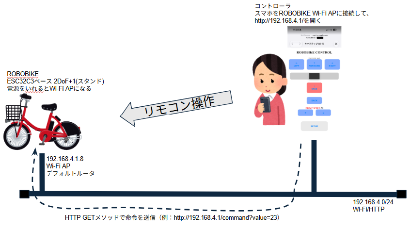
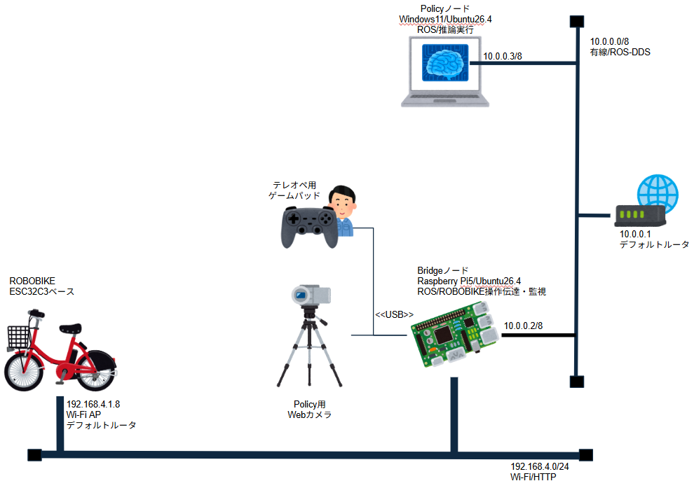

# ROBOBIKE Bridge

<p align="center">
  <picture>
    <source
      media="(prefers-color-scheme: dark)"
      srcset="./assets/title_black_back.png">
    <source
      media="(prefers-color-scheme: light)"
      srcset="./assets/title.png">
    
  </picture>
</p>
<!--  -->
本リポジトリは、 [ROBOBIKE](https://robobikejp.com/) をROS2 Lyrical Luth を使った自律走行運転を実現するためのプログラムを提供します。


## 1. ROBOBIKE システム



[ROBOBIKE](https://robobikejp.com/) は、[モバイルロボット研究会](https://robobike.jp) が開発・販売しているスマートフォンを使って操作するリモコン2輪走行ロボットです。

> 購入時の価格は8,800円（税込）

販売されている ROBOBIKE をそのまま使用しています（一切改変を加えていません）。

### 1.1 駆動系

- 前輪(ステアリング) マイクロサーボ [MG90S](https://akizukidenshi.com/catalog/g/g113227/) ※操舵のみ、駆動なし

 

- 後輪(駆動) マイクロサーボ [MG90D](https://akizukidenshi.com/catalog/g/g113226/) ※写真左下の四角い箱、駆動のみ

 

- サイドスタンド マイクロサーボ [MD90S](https://akizukidenshi.com/catalog/g/g113227/) ※サイドスタンド昇降のみ


### 1.2 コントローラ(ROBOBIKE搭載基盤)

- [基盤図PCBA](https://github.com/tneurjpy-cloud/robobike/blob/main/doc/ROBOBIKE05_PCBA.pdf)
    - Wi-Fiモジュール [ESP32-C3-WROOM-02-N4](https://akizukidenshi.com/catalog/g/g117493/)
        - 国内使用可能（技適取得済み　R 201-220555）
        - 電源ONすることで、Wi-Fi APとして動作→接続すると、ロボット側が 192.168.4.1 となる
    - USB-Cコネクタ経由で充電

### 1.3 バッテリ

- LJ Li-ion 2.96V 14500/800mAh

## 2. ROBOBIKE Bridge システム



### 2.1 テレオペデバイス（ゲームパッド）

テレオペは、XBox互換ゲームパッドを使用しました。

- Elecom JC-U4113S X-mode
    - USBドングルをBridgeノードに接続

## 2.2 Bridge ノード（Raspberry Pi）


Bridgeノードは主にROS2夜ピック通信とROBOBIKEのブリッジとして機能します。
Wi-Fi回線を使用しているため、学習用データセット収集はこのノード上で一旦溜め込みます。

- Raspberry Pi 5 16GB
- Ubuntu Desktop 26.04.01 LTS
    - ROS2 Lyrical Luth
    - OpenCV
- SSD 512GB
- 有線LAN：10.0.0.0/8
    - ROS2/DDS 通信
    - インターネット通信(パッケージ更新、gitリポジトリのクローンなど)
- 無線LAN：192.168.4.0/24
    - ファームウェア提供の操作用Webアプリが使用している、APIを直接呼出し
        - HTTP GETベースなので、curlでも操作可能
- Webカメラ(UCB)
    - サンワサプライ USB書画カメラ [CMS-V46W](https://www.sanwa.co.jp/product/syohin?code=CMS-V46W)


## 2.3 Policy ノード(PC)

Raspberry Pi 5 では方策(Policy)の推論が実時間で間に合わないため、GPU 搭載の Linux PC を別途用意して、この上で学習・推論を行っています。

Bridgeノードで収集したデータセットをACTで扱える形式にデータ変換し、これをもとにGPUを使ってトレーニング処理を実行、作成したモデルをもとにROS2サブスクライバとして推論実行結果を送信します。

- Linux PC
    - Ubuntu 26.04 LTS(Docker・WSL は使用しない)
        - ROS2 Lyrical Luth(Python 3.14)
    - GPU：NVIDIA GeForce RTX 3080
    - 無線LAN：10.0.0.0/8(Raspberry Pi と DDS で通信)
    - Policy：[LeRobot](https://github.com/huggingface/lerobot) ACT(Action Chunking Transformer)
        - 入力：俯瞰カメラ画像(320x240)＋テレメトリ・ステータス(11項目)
        - 出力：操舵値(速度はゲームパッドで人が操作)


### 2.4 ネットワーク構成

以下の2系統で運用しています。

- 有線LAN(Raspberry Pi は Wi-Fi 中継器の有線ポート経由、PC は無線で接続)
    - 10.0.0.0/8
    - 10.0.0.1 デフォルトルータ：家庭用ルータ(DHCP)
    - 10.0.0.X ポリシーデバイス: Linux PC
    - 10.0.0.Y モニターデバイス: Raspberry Pi 5
    - 帯域の都合で、カメラ画像は 320x240 JPEG・10Hz で送信しています

- 無線LAN
    - 192.168.4.0/24
    - 192.168.4.1 デフォルトルータ兼ロボットデバイス：ROBOBIKE
    - 192.168.4.X モニターデバイス: Raspberry Pi 5


### 2.5 ソフトウェア構成

ROS2 パッケージ `bridge`(`src/bridge`)と、PC 専用の学習データ変換スクリプト(`policy`)で構成しています。

| ノード | 実行場所 | 内容 |
|---|---|---|
| `pub_image` | Raspberry Pi | 俯瞰カメラ画像の配信 |
| `pub_status` / `pub_telemetry` | Raspberry Pi | ROBOBIKE のステータス・テレメトリの配信 |
| `pub_command_pad` | Raspberry Pi | ゲームパッド操作をコマンドに変換(START/BACK でエピソード開始/終了) |
| `sub_command` | Raspberry Pi | コマンドを ROBOBIKE に送信(`--watchdog` で方策の停止時に緊急停止) |
| `record_session` | Raspberry Pi | ros2 bag(mcap)で学習データを記録 |
| `pub_command_policy` | PC | 学習済み方策で推論し、操舵コマンドを送信 |
| `dummybike` | どちらでも | ROBOBIKE の代わりのダミーサーバ(実機なしのテスト用) |
| `calibration` | Raspberry Pi | 走行開始時の速度設定値(mot_spd)の調整 |

Raspberry Pi 側は launch ファイルでまとめて起動します。

```bash
ros2 launch bridge collect.launch.py                  # 学習データの収集(記録あり)
ros2 launch bridge collect.launch.py watchdog:=true   # 方策で走行(PC で pub_command_policy を実行)
ros2 launch bridge collect.launch.py dummy:=true      # dummybike で動作確認(実機不要)
```

学習データの変換・学習・推論の手順は [policy/README.md](./policy/README.md) を参照してください。
データセット・学習結果は `~/robobike_data`(環境変数 `ROBOBIKE_DATA_DIR` で変更可)に保存します。

## 現状と既知の問題

- 収集 → 変換 → 学習 → 推論 → ROBOBIKE へのコマンド送信まで、一連の動作を確認済みです
- ゲームパッドでの手動運転が難しく(すぐに転倒する)、学習データはまだごく少量です。そのため学習済み方策で走行できる段階には至っていません
- ROBOBIKE が Wi-Fi の届く範囲外に出ると、ROBOBIKE が待機状態になり、電源の入れ直しが必要になります
- Ctrl+C で終了すると `process has died` などのエラーが表示されることがあります(動作には影響しません)
- `colcon test` のコードスタイル検査(flake8・pep257・mypy)には未対応の指摘が残っています(機能テストは成功)

## ROS_DOMAIN_ID

```bash
export ROS_DOMAIN_ID=10
```

## 参考

- ROBOBIKE
    - [ROBOBIKE公式サイト](https://robobikejp.com/)
        - [技術解説編](https://robobikejp.com/rctech02/)
    <!-- - [ROBOBIKE ファームウェア GitHubリポジトリ](https://github.com/tneurjpy-cloud/robobike) -->
    - ROBOBIKE ファームウェア GitHubリポジトリ
        URL公開されていたが、現在では公式サイトからの申し込みが必要
    - [ROBOBIKE 仕様 分析結果](./doc/controller_map.md)

## ライセンス

- [MIT License](./LICENSE)

## 備考

- ROBOBIKE はモバイルロボット研究会の登録商標です。
- 本リポジトリのテスト・動作チェックでは、実機に積載されている人形を Figma に変更しています（開発・販売元の保証する状態での使用ではありません）。
- 本リポジトリは [Physical AI講座応用編1](https://weblab.t.u-tokyo.ac.jp/lecture/course-list/physical-ai/advanced1/) 最終課題として提出したものです。

<p align="right">以上</p>
