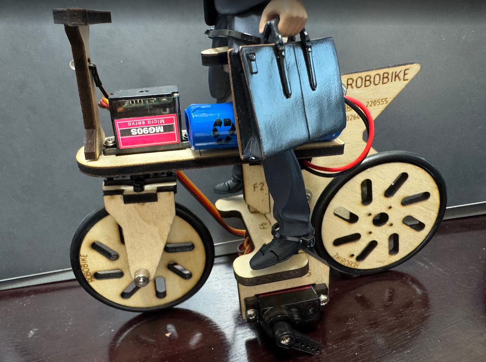
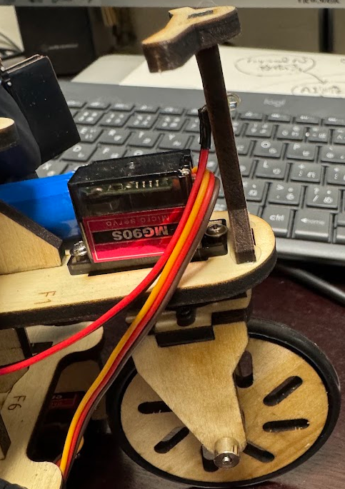
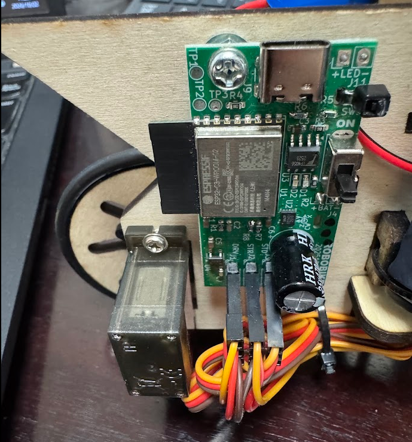
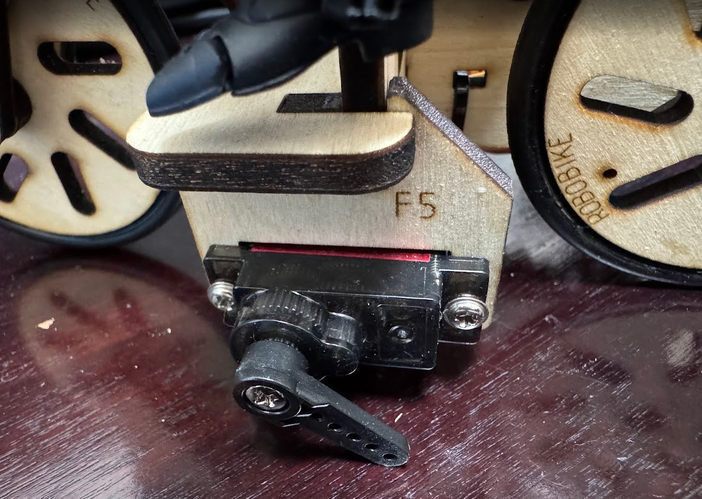
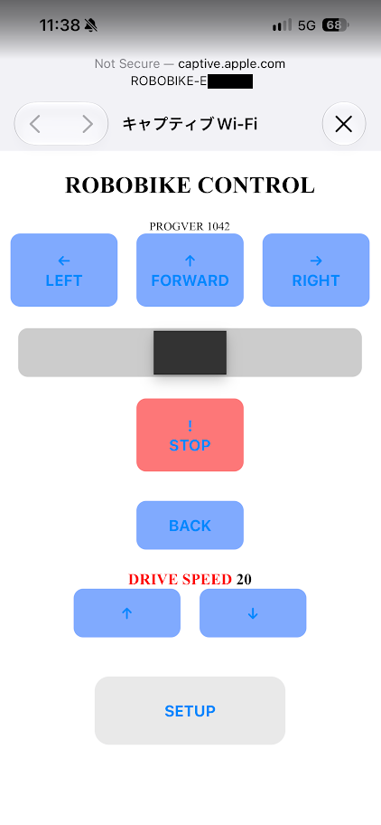
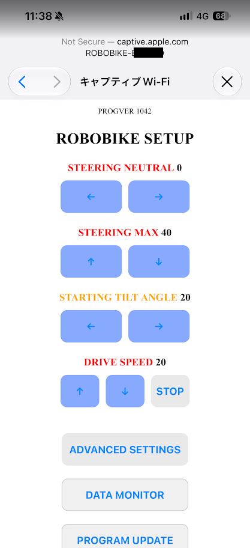
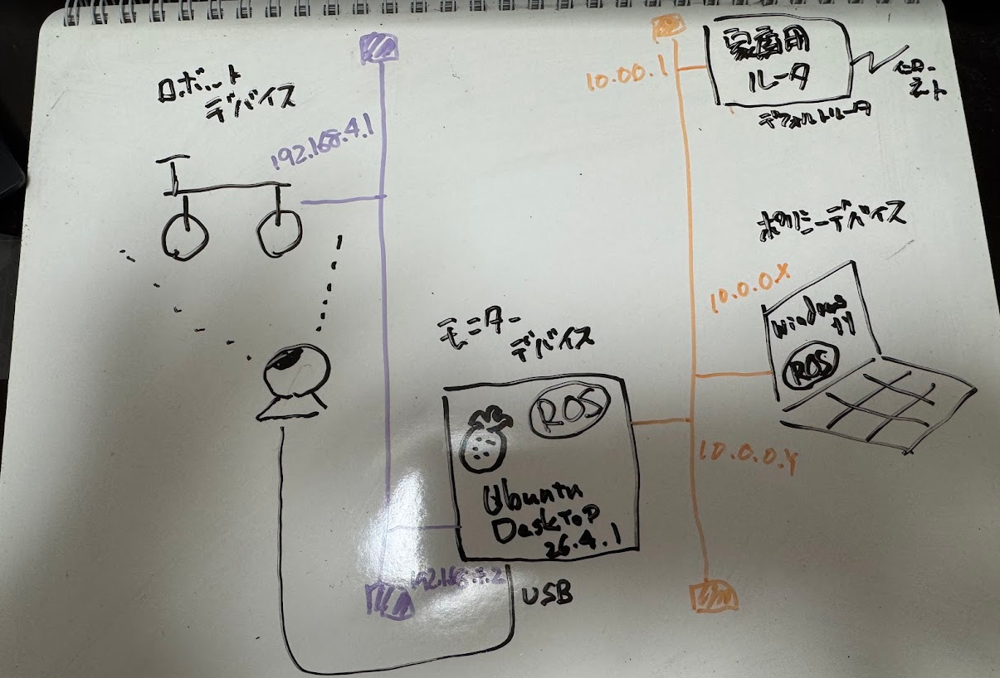

# ROBOBIKE Bridge



本リポジトリは、[ROBOBIKE](https://robobikejp.com/) をROS2 Lyrical Luth を使った自律走行運転を実現するためのプログラムを提供します。


## ロボットデバイス（ROBOBIKE）

[ROBOBIKE](https://robobikejp.com/) は、[モバイルロボット研究会](https://robobike.jp) が開発・販売しているスマートフォンを使って操作するリモコン2輪走行ロボットです。

> 購入時の価格は8,800円（税込）

販売されている ROBOBIKE をそのまま使用しています（一切改変を加えていません）。

### 自由度3

- 前輪(ステアリング) マイクロサーボ [MG90S](https://akizukidenshi.com/catalog/g/g113227/) ※操舵のみ、駆動なし

 

- 後輪(駆動) マイクロサーボ [MG90D](https://akizukidenshi.com/catalog/g/g113226/) ※写真左下の四角い箱、駆動のみ

 

- サイドスタンド マイクロサーボ [MD90S](https://akizukidenshi.com/catalog/g/g113227/) ※サイドスタンド昇降のみ



### コントローラ(ROBOBIKE搭載基盤)

- [基盤図PCBA](https://github.com/tneurjpy-cloud/robobike/blob/main/doc/ROBOBIKE05_PCBA.pdf)
    - Wi-Fiモジュール [ESP32-C3-WROOM-02-N4](https://akizukidenshi.com/catalog/g/g117493/)
        - 国内使用可能（技適取得済み　R 201-220555）
        - 電源ONすることで、Wi-Fi APとして動作→接続すると、ロボット側が 192.168.4.1 となる
    - USB-Cコネクタ経由で充電

### バッテリ

- LJ Li-ion 2.96V 14500/800mAh

## テレオペデバイス（スマートフォン）

テレオペは、ROBOBIKEの操作用Webアプリをそのまま使用しました。

- 充電済みROBOBIKEの電源ON
- スマートフォンのWi-Fi設定を変更(SSIDは、ROBOBIKE-XXXXXX)

- 操作用Webアプリ
    - 操作画面（手動運転、テレオペ用アプリとして使用）
    - セットアップ画面（初期設定値、キャリブレーション）




## モニターデバイス（Raspberry Pi）

- Raspberry Pi 5 16GB
- Ubuntu Desktop 26.04.01 LTS
    - ROS2 Lyrical Luth
    - OpenCV
- SSD 512GB
- 有線LAN：10.0.0.0/8
    - ROS2/DDS 通信
    - インターネット通信(パッケージ更新、gitリポジトリのクローンなど)
- 無線LAN：192.168.4.0/24
    - ファームウェア提供の操作用Webアプリが使用している、APIを直接呼出し
        - HTTP GETベースなので、curlでも操作可能
- Webカメラ(UCB)
    - サンワサプライ USB書画カメラ [CMS-V46W](https://www.sanwa.co.jp/product/syohin?code=CMS-V46W)


## ポリシーデバイス(PC)

Raspberry Pi 5で動作させるPolicyがおもいつかなかったため、Windows PCを別途用意して、この上でPolicyを動作させています。

- Windows 11 PC
    - 有線LAN：10.0.0.0/8
    - WSL3
        - Ubuntu 26.04.01 LTS
            - ROS2 Lyrical Luth
            - Policy:TBD


## ネットワーク構成

以下の2系統で運用しています。

- 有線LAN
    - 10.0.0.0/8
    - 10.0.0.1 デフォルトルータ：家庭用ルータ(DHCP)
    - 10.0.0.X ポリシーデバイス: Windows11 PC
    - 10.0.0.Y モニターデバイス: Raspberry Pi 5

- 無線LAN
    - 192.168.4.0/24
    - 192.168.4.1 デフォルトルータ兼ロボットデバイス：ROBOBIKE
    - 192.168.4.X モニターデバイス: Raspberry Pi 5




## ROS_DOMAIN_ID

```bash
export ROS_DOMAIN_ID=10
```

## 参考

- ROBOBIKE
    - [ROBOBIKE公式サイト](https://robobikejp.com/)
        - [技術解説編](https://robobikejp.com/rctech02/)
    <!-- - [ROBOBIKE ファームウェア GitHubリポジトリ](https://github.com/tneurjpy-cloud/robobike) -->
    - ROBOBIKE ファームウェア GitHubリポジトリ
        URL公開されていたが、現在では公式サイトからの申し込みが必要

## ライセンス

- [MIT License](./LICENSE)

## 備考

- ROBOBIKE はモバイルロボット研究会の登録商標です。
- 本リポジトリのテスト・動作チェックでは、実機に積載されている人形を Figma に変更しています（開発・販売元の保証する状態での使用ではありません）。
- 本リポジトリは [Physical AI講座応用編1](https://weblab.t.u-tokyo.ac.jp/lecture/course-list/physical-ai/advanced1/) 最終課題として提出したものです。

<p align="right">以上</p>
