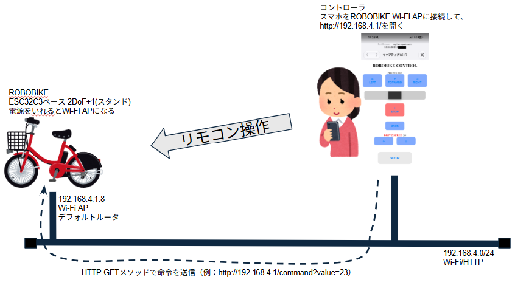
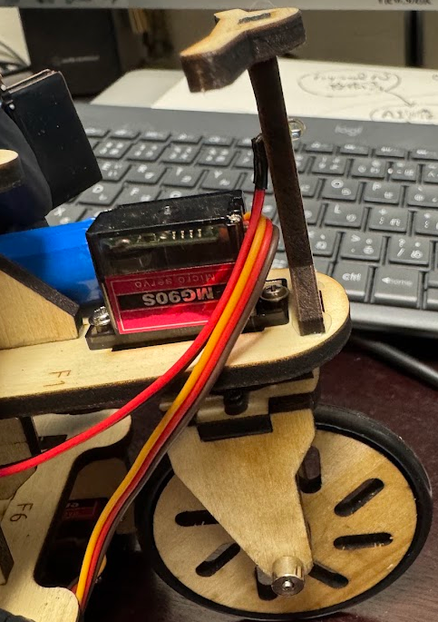
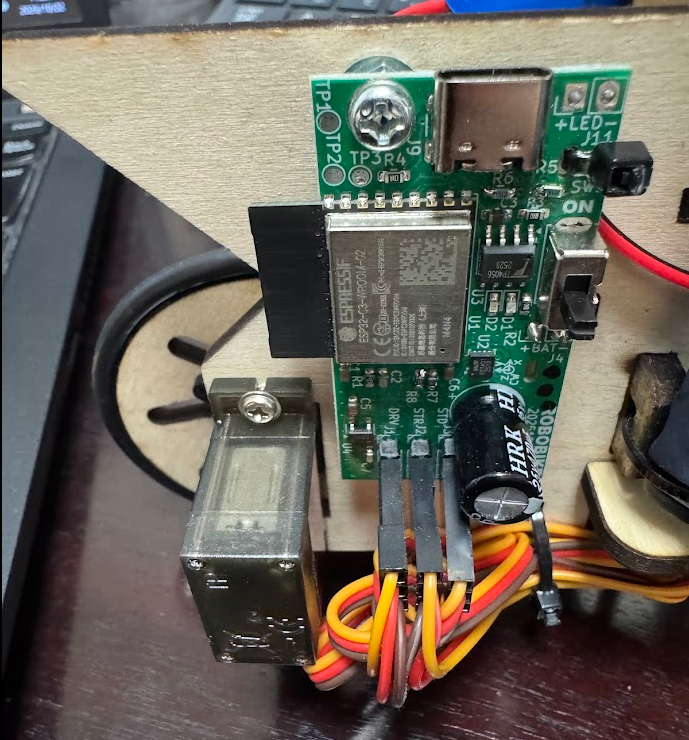
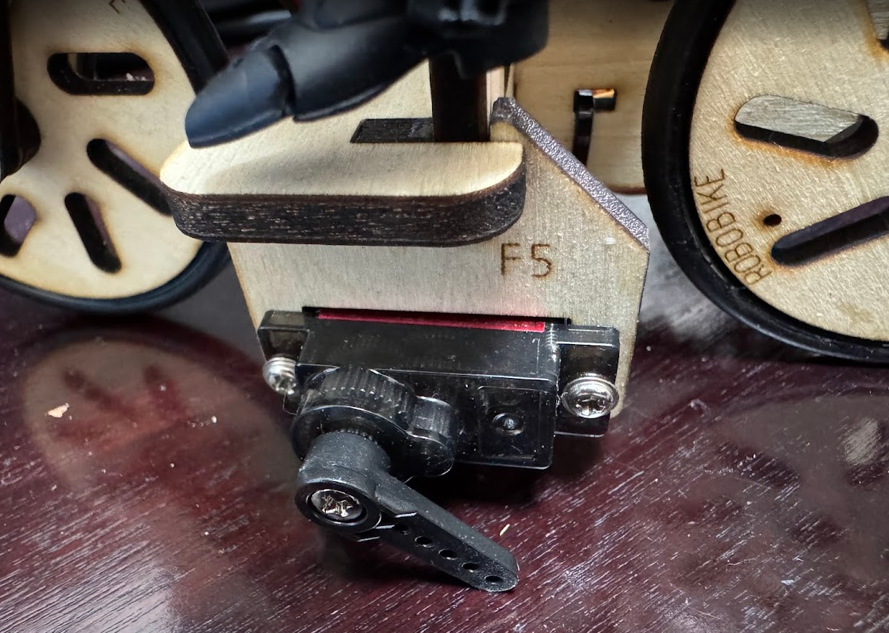
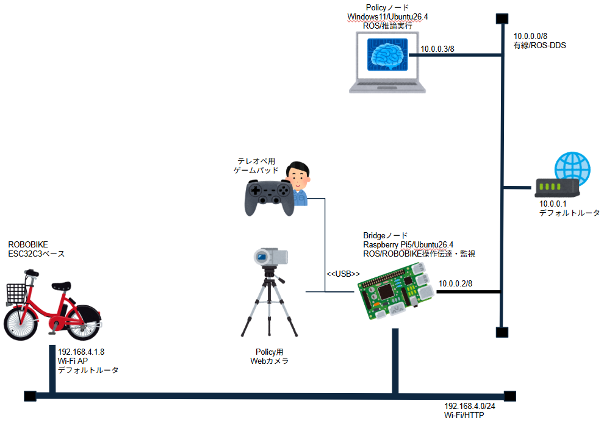
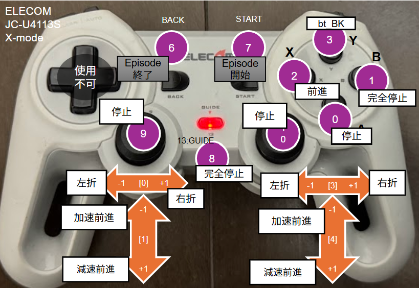
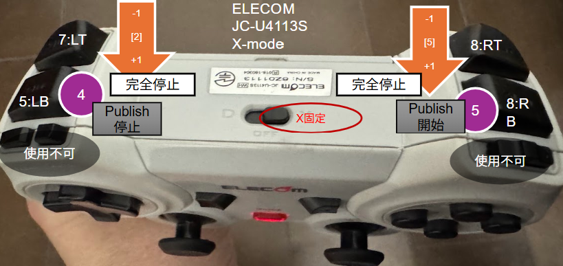

# ROBOBIKE Bridge

<p align="center">
  <picture>
    <source
      media="(prefers-color-scheme: dark)"
      srcset="./assets/title_black_back.png">
    <source
      media="(prefers-color-scheme: light)"
      srcset="./assets/title.png">
    
  </picture>
</p>
本リポジトリは、 [ROBOBIKE](https://robobikejp.com/) をROS2 Lyrical Luth を使った自律走行運転を実現するためのプログラムを提供します。


## 1. ROBOBIKE システム

本リポジトリではROBOBIKE本体が1台必要です。
ROBOBIKEを入手すると、ROBOBIKEをリモートで手動運転するシステムが利用できるようになります（本リポジトリでは、ROBOBIKEシステムと呼称）。



[ROBOBIKE](https://robobikejp.com/) は、[モバイルロボット研究会](https://robobike.jp) が開発・販売しているスマートフォンを使って操作するリモコン2輪走行ロボットです。

> 購入時の価格は8,800円（税込）

販売されている ROBOBIKE をそのまま使用しています（一切改変を加えていません）。

- [ROBOBIKE 仕様分析](./doc/controller_map.md)

### 1.1 駆動系

- 前輪(ステアリング) マイクロサーボ [MG90S](https://akizukidenshi.com/catalog/g/g113227/) ※操舵のみ、駆動なし

 

- 後輪(駆動) マイクロサーボ [MG90D](https://akizukidenshi.com/catalog/g/g113226/) ※写真左下の四角い箱、駆動のみ

 

- サイドスタンド マイクロサーボ [MD90S](https://akizukidenshi.com/catalog/g/g113227/) ※サイドスタンド昇降のみ



### 1.2 コントローラ(ROBOBIKE搭載基盤)

- [基盤図PCBA](https://github.com/tneurjpy-cloud/robobike/blob/main/doc/ROBOBIKE05_PCBA.pdf)
    - Wi-Fiモジュール [ESP32-C3-WROOM-02-N4](https://akizukidenshi.com/catalog/g/g117493/)
        - 国内使用可能（技適取得済み　R 201-220555）
        - 電源ONすることで、Wi-Fi APとして動作→接続すると、ロボット側が 192.168.4.1 となる
    - USB-Cコネクタ経由で充電

### 1.3 バッテリ

- LJ Li-ion 2.96V 14500/800mAh

## 2. ROBOBIKE Bridge システム

本リポジトリでは、ROBOBIKEシステムを自動運転化する機能を包括して「ROBOBIKE Bridge システム」と呼称しています。
ROBOBIKE Bridgeシステムのすべての機能を実行するためには、（ROBOBIKE本体以外に）以下のものが必要になります。



### 2.1 テレオペデバイス（ゲームパッド）

テレオペは、XBox互換ゲームパッドを使用しました。

- Elecom JC-U4113S X-mode
    - USBドングルをBridgeノードに接続

### 2.2 Bridge ノード（Raspberry Pi＋カメラ）


Bridgeノードは主にROS2トピック通信とROBOBIKEのブリッジとして機能します。
Wi-Fi回線を使用しているため、学習用データセット収集はこのノード上で一旦溜め込みます。

- Raspberry Pi 5 16GB
- Ubuntu Desktop 26.04.01 LTS
    - ROS2 Lyrical Luth
    - OpenCV
- SSD 512GB
- 有線LAN：10.0.0.0/8
    - ROS2/DDS 通信
    - インターネット通信(パッケージ更新、gitリポジトリのクローンなど)
- 無線LAN：192.168.4.0/24
    - ファームウェア提供の操作用Webアプリが使用している、APIを直接呼出し
        - HTTP GETベースなので、curlでも操作可能
- Webカメラ(USB)
    - サンワサプライ USB書画カメラ [CMS-V46W](https://www.sanwa.co.jp/product/syohin?code=CMS-V46W)


### 2.3 Policy ノード(PC)

Raspberry Pi 5 では方策(Policy)の推論が実時間で間に合わないため、GPU 搭載の Linux PC を別途用意して、この上で学習・推論を行っています。

Bridgeノードで収集したデータセットをACTで扱える形式にデータ変換し、これをもとにGPUを使ってトレーニング処理を実行、作成したモデルをもとにROS2サブスクライバとして推論実行結果を送信します。

- Linux PC
    - Ubuntu 26.04 LTS(Docker・WSL は使用しない)
        - ROS2 Lyrical Luth(Python 3.14)
    - GPU：NVIDIA GeForce RTX 3080
    - 無線LAN：10.0.0.0/8(Raspberry Pi と DDS で通信)
    - Policy：[LeRobot](https://github.com/huggingface/lerobot) ACT(Action Chunking Transformer)
        - 入力：俯瞰カメラ画像(320x240)＋テレメトリ・ステータス(11項目)
        - 出力：操舵値(速度はゲームパッドで人が操作)


### 2.4 ネットワーク構成

以下の2系統で運用しています。

- 家庭内LAN(Raspberry Pi は Wi-Fi 中継器の有線ポート経由、PC は家庭用ルータに無線で接続)
    - 10.0.0.0/8
    - 10.0.0.1 デフォルトルータ：家庭用ルータ(DHCP)
    - 10.0.0.X ポリシーデバイス: Linux PC
    - 10.0.0.Y モニターデバイス: Raspberry Pi 5
    - 帯域の都合で、カメラ画像は 320x240 JPEG・10Hz で送信しています

- ROBOBIKE LAN(ROBOBIKE が Wi-Fi AP として提供、Raspberry Pi の無線LANで接続)
    - 192.168.4.0/24
    - 192.168.4.1 デフォルトルータ兼ロボットデバイス：ROBOBIKE
    - 192.168.4.X モニターデバイス: Raspberry Pi 5

## 3. ROBOBIKE Bridge システム ソフトウェア

本リポジトリは、ROBOBIKE Bridge システムを実現するためのソフトウェアを提供します。

### 3.1 ソフトウェア構成

ROS2 パッケージ `bridge` ( `src/bridge` )と、PC 専用の学習データ変換スクリプト(`policy`)で構成しています。

| ノード | 実行場所 | 内容 |
|---|---|---|
| `pub_image` | Raspberry Pi | 俯瞰カメラ画像の配信 |
| `pub_status` / `pub_telemetry` | Raspberry Pi | ROBOBIKE のステータス・テレメトリの配信 |
| `pub_command_pad` | Raspberry Pi | ゲームパッド操作をコマンドに変換(START/BACK でエピソード開始/終了) |
| `sub_command` | Raspberry Pi | コマンドを ROBOBIKE に送信(`--watchdog` で方策の停止時に緊急停止) |
| `record_session` | Raspberry Pi | ros2 bag(mcap)で学習データを記録 |
| `pub_command_policy` | PC | 学習済み方策で推論し、操舵コマンドを送信 |
| `dummybike` | どちらでも | ROBOBIKE の代わりのダミーサーバ(実機なしのテスト用) |
| `calibration` | Raspberry Pi | 走行開始時の速度設定値(mot_spd)の調整 |
| `sub_image` / `sub_status` / `sub_telemetry` | どちらでも | 動作確認用(画像の表示、ステータス・テレメトリのログ出力) |


## 4. セットアップ

本リポジトリでは ROS2 を使用していますが、複数のノードを別々のコンピュータで実行します。このため両方のコンピュータの環境変数 ROS_DOMAIN_ID に同じ値を指定してください。

本リポジトリでは 10 を指定していることを前提として記述しています。

```bash
export ROS_DOMAIN_ID=10
```

### 4.1 Bridge ノード

「[Ubuntu Desktop 26.04 LTS/Raspberry Pi 5(16GB) に ROS2 (Lyrical Luth) をインストールする方法](./doc/setup_ros2_on_rpi5.md)」をもとに、セットアップしてください。

### 4.2 Policy ノード

Policyノードでは、方策(Policy)の学習・推論を実行する機能をもたせるため、PCを用意してください。
PCには「[Ubuntu Desktop 26.04 LTS/Raspberry Pi 5(16GB) に ROS2 (Lyrical Luth) をインストールする方法](./doc/setup_ros2_on_rpi5.md)」のセクション2以降は同じですので、リンクを参考にセットアップしてください。

> ホストPCがUbuntu以外の場合、DockerやWSLなどのコンテナ運用ソフトウェアをもちいてUbuntu 26.4 LTSイメージを起動し、リンクのセクション2以降を参考にセットアップしてください。
> 

## 5. 実行方法

Raspberry Pi 側は launch ファイルでまとめて起動します。

`~/ros_ws` 以下で本リポジトリをcloneしている場合は以下の順番で実行します

### 5.1 Bridgeノード


```bash
source /opt/ros/lyrical/setup.bash
cd ~/ros_ws/robobike_bridge
source install/setup.bash
ros2 launch bridge collect.launch.py                  # 学習データの収集(記録あり)
ros2 launch bridge collect.launch.py dummy:=true      # dummybike で動作確認(実機不要)
```

> 実機を停止している・購入していない場合、dummybike.py にダミーサーバを実行できるようにしています。
> ただし、すべて同じ値しか返さないので、学習データセットを作っても（動作はするとおもいますが）、学習した方策は使用しないでください。

### 5.2 Policyノード

```bash
source /opt/ros/lyrical/setup.bash
cd ~/ros_ws/robobike_bridge
source install/setup.bash
ros2 launch bridge collect.launch.py watchdog:=true   # 方策で走行(PC で pub_command_policy を実行)
```


## 6. 操作方法

学習データを作成するためには、手動でROBOBIKEを実際に運転してデータを作成する必要があります。
Bridgeノードに接続したゲームパッドは、以下のコマンドを設定しています。





> LT/RT はボタンではなくアナログ軸(軸番号 2・5)として読み取り、軸値が 0.7 以上になると緊急停止コマンド(`stp_all`)を送信します。この割り当ては Elecom JC-U4113S X-mode を前提にしています。
> トリガを離した状態の軸値が +1.0 になるゲームパッドや、軸番号の割り当てが異なるゲームパッドでは、操作していなくても `stp_all` が送信されることがあります。
> 他の機種を使う場合は、事前に `ros2 topic echo /robobike_command` で意図しないコマンドが出ていないことを確認し、必要に応じて `src/bridge/bridge/pad_constants.py` の割り当てを変更してください。

### 6.1 操作例

GUIDEボタンが点灯していると、Bridgeノードと接続できています（点滅時は接続中）。点灯していることを確認し、前章のプログラムが動作している状態にしてから、操作を行ってください。

1. ROBOBIKEを初期位置におく
2. STARTボタン押下（新エピソード開始、同時にPublishも開始される）
3. Xボタン押下(前進)
4. 左もしくは右のアナログをつかって操作
5. 予定位置にきたら、Aボタンを押下（停止）
    - 失敗した場合、BACKボタン押下でエピソードを終了する
    - 緊急停止は、LT/RTボタンを押下すること
6. BACKボタン押下（エピソード終了）


## 7. 学習データの変換・学習・推論

学習データの変換・学習・推論の手順は [policy/README.md](./policy/README.md) を参照してください。
データセット・学習結果は `~/robobike_data`(環境変数 `ROBOBIKE_DATA_DIR` で変更可)に保存します。

## 8. 現状と既知の問題

- 収集 → 変換 → 学習 → 推論 → ROBOBIKE へのコマンド送信まで、一連の動作を確認済みです
- ゲームパッドでの手動運転が難しく(すぐに転倒する)、学習データはまだごく少量です。そのため学習済み方策で走行できる段階には至っていません
- ROBOBIKE が Wi-Fi の届く範囲外に出ると、ROBOBIKE が待機状態になり、電源の入れ直しが必要になります
- Ctrl+C で終了すると `process has died` などのエラーが表示されることがあります(動作には影響しません)
- `colcon test` のコードスタイル検査(flake8・pep257・mypy)には未対応の指摘が残っています(機能テストは成功)

### 8.1 未対応の課題

コードレビュー(2026年11月1日)で指摘を受け、未対応のものです。

- テレメトリ取得(`RobobikeBridge.get_telemetry()`)の HTTP タイムアウトが 60 秒になっています(他の HTTP 呼び出しは 1 秒)。ROBOBIKE が応答しなくなると、`pub_telemetry` の配信が最大 60 秒止まります。方策で走行中は入力の鮮度チェックとウォッチドッグで停止します。起動直後など ROBOBIKE 側のバッファがたまった状態の応答時間を実機で確認してから見直す予定です
- `pub_command_policy` は、操舵を停止している間も推論とハートビートの送信を続けます。そのため GPU を使い続けるほか、手動運転中に `pub_command_policy` を起動したままにすると、画像などの入力が途絶えたときにウォッチドッグが緊急停止します
- `RobobikeBridge.send_command()` は value(操舵値)を検証・正規化しません。`sub_command` 経由では正規化されますが、`calibration` のように直接呼び出す場合は、範囲外の値や value の欠落がそのまま送信されます
- ゲームパッドのボタンに value 付きのコマンド(`bt_Str_S`)を割り当てると、value は 100 固定で送信されます(現在の割り当てには該当なし)
- `constants.py` の `DEBUG` が `True` 固定で、デバッグ出力に `print` と ROS2 ロガーが混在しています
- `record_session` の保存先ディレクトリ名は秒単位の日時のため、同じ秒に 2 回起動すると保存先が衝突します
- `policy/convert_bag.py` は、フレームの作成中に例外(項目の欠落など)が発生すると変換全体が途中で止まります。エピソード単位でスキップする処理はありません

今後の検討事項として、GitHub Actions による `colcon test` の自動実行、学習・推論用 venv の依存パッケージの固定(requirements ファイル)、トピックのカスタムメッセージ型への移行、パッケージの分割(Pi 側・PC 側)があります。


## A. ライセンス

- [MIT License](./LICENSE)

## B. その他

### B.1 設計

- [要件定義、システム化対象の決定](./doc/requirement_artifact.md)
- [アーキテクチャ設計](./doc/architecture_design.md)

### B.2 参考

- ROBOBIKE
    - [ROBOBIKE公式サイト](https://robobikejp.com/)
        - [技術解説編](https://robobikejp.com/rctech02/)
    <!-- - [ROBOBIKE ファームウェア GitHubリポジトリ](https://github.com/tneurjpy-cloud/robobike) -->
    - ROBOBIKE ファームウェア GitHubリポジトリ
        URL公開されていたが、現在では公式サイトからの申し込みが必要
    - [ROBOBIKE 仕様 分析結果](./doc/controller_map.md)


### B.3 備考

- ROBOBIKE はモバイルロボット研究会の登録商標です。
- 本リポジトリのテスト・動作チェックでは、実機に積載されている人形を Figma に変更しています（開発・販売元の保証する状態での使用ではありません）。
- 本リポジトリは [Physical AI講座応用編1](https://weblab.t.u-tokyo.ac.jp/lecture/course-list/physical-ai/advanced1/) 最終課題として提出したものです。

<p align="right">以上</p>
