# アーキテクチャ設計「ROBOBIKE Bridgeシステム」

## 1. はじめに
### 1.1. 本書の目的

本書は、「ROBOBIKE Bridgeシステム」のアーキテクチャを定義する。対象は次のとおり。

- システム全体の構成(ハードウェア・ネットワーク・ソフトウェア)とその選定理由
- 構成要素間のインタフェース(ROS2トピック、ROBOBIKE HTTP API、データファイル)
- 安全停止・データ収集・学習・推論といった横断的な仕組み

想定読者は、本リポジトリを改修・再現する開発者と、課題の評価者である。
何を実現するか(ユースケース)は[要件定義書](./requirement_artifact.md)で定義している。本書はそれを「どう実現しているか」を記述する。

### 1.2. 対象システム概要

ROBOBIKE Bridgeシステムは、市販の二輪走行ロボット [ROBOBIKE](https://robobikejp.com/) に ROS2 と模倣学習を適用し、学習済み方策(Policy)による自律走行を目指すシステムである。

- **背景**：ROBOBIKE はスマートフォンのブラウザから Wi-Fi(HTTP)で手動操作する製品である。外部から観測・操作・記録する仕組みを持たない
- **目的**：既存のロボットに Physical AI 技術を適用するときの設計・実装を、実機を使って体系的に理解する
- **提供価値**
    - ROBOBIKE 本体・ファームウェアを**一切改変せず**に、ROS2 から観測・操作・記録できる
    - ゲームパッドによるテレオペで学習データを収集し、LeRobot ACT で操舵方策を学習・推論する一連のパイプラインを提供する
    - 方策の停止や通信途絶を検知して緊急停止する安全機構を持つ

実装範囲は段階化しており、**操舵は学習済み方策、速度は人がゲームパッドで操作**する。現時点では「収集 → 変換 → 学習 → 推論 → 実機へのコマンド送信」の接続まで確認済みである。学習済み方策による走行には至っていない。

### 1.3. 用語の定義・略語表

|用語・略語|定義|
|---|---|
|ROBOBIKE|モバイルロボット研究会が販売する二輪走行ロボット。ESP32-C3 が Wi-Fi AP(192.168.4.1)として動作し、HTTP GET で操作を受け付ける|
|ROBOBIKEシステム|ROBOBIKE とスマートフォン(Web操作画面)からなる、改変前の手動操作システム|
|Bridgeノード|Raspberry Pi 5 上で動作する機能ブロック。ROS2 と ROBOBIKE HTTP API の橋渡し、カメラ・ゲームパッドの入力、データ記録を担う|
|Policyノード|GPU 搭載 Linux PC 上で動作する機能ブロック。データ変換・方策学習・推論を担う。役割の名称であり、ROS2 パッケージ名ではない|
|方策(Policy)|観測(画像・状態)から行動(操舵値)を出力する学習済みモデル|
|ACT|Action Chunking with Transformers。観測から複数ステップ分の行動列(チャンク)を予測する模倣学習手法|
|LeRobot|Hugging Face が提供するロボット学習ライブラリ。本システムでは 0.6.1 を使用|
|LeRobotDataset|LeRobot の学習用データセット形式|
|ステータス|ROBOBIKE が保持する設定パラメータ群(`mot_spd`、`str0`、`gain_str` など)。`command?button=2`(only_data)で取得|
|テレメトリ|ROBOBIKE の観測データ群(駆動・操舵出力、サーボ位置、IMU)。`/get_acc` で CSV として取得|
|コマンド|ROBOBIKE への操作命令。37種類のボタン番号と、操舵値(`bt_Str_S` のみ)からなる|
|`mot_spd`|ROBOBIKE のモータ速度設定値|
|エピソード|学習データの1試行。ゲームパッドの START で開始し、BACK/LB/切断で終了する|
|セッション|`collect.launch.py` の起動から終了までの1回の記録。1つの ros2 bag になる|
|ハートビート|推論ノードが制御周期ごとに配信する生存信号|
|ウォッチドッグ|ハートビートの途絶を検知して緊急停止する `sub_command` の機能|
|DDS|Data Distribution Service。ROS2 のノード間通信ミドルウェア|
|QoS|Quality of Service。ROS2 トピックの信頼性・履歴などの通信品質設定|
|MCAP|ros2 bag の保存形式の一つ|

### 1.4. 関連ドキュメント

|ドキュメント|内容|
|---|---|
|[README.md](../README.md)|システム概要、ハードウェア構成、セットアップ・実行・操作方法|
|[要件定義書](./requirement_artifact.md)|XYZ分析、システムコンテキスト、ユースケース(UC01〜UC21)|
|[ROBOBIKE 仕様 分析結果](./controller_map.md)|ROBOBIKE HTTP API・ステータス・テレメトリの分析結果|
|[ROS2 セットアップ手順](./setup_ros2_on_rpi5.md)|Raspberry Pi 5 / PC への ROS2 Lyrical Luth のインストール手順|
|[policy/README.md](../policy/README.md)|学習データ変換・学習・推論の手順と Python 環境|
|[最終課題レポート](./report.md)|課題の目的・成果・考察|

## 2. システム要件と制約事項
### 2.1. 前提条件と制約事項

|区分|制約事項|アーキテクチャへの影響|
|---|---|---|
|対象機器|ROBOBIKE の駆動系・制御基板・ファームウェアは改変しない(ライセンス未明記のため)|既存の HTTP API のみで観測・操作する。バランス制御はファームウェアに任せ、本システムはその上位で操舵値を与える|
|ROBOBIKE 通信|ROBOBIKE は Wi-Fi AP として動作し、HTTP GET の往復に約80msかかる。Wi-Fi 圏外に出ると待機状態になり、電源の入れ直しが必要|制御周期・画像配信周期を10Hzとする。圏外にならない走行範囲で運用する|
|計算資源|Raspberry Pi 5 では ACT の推論が実時間で間に合わない|推論を GPU 搭載 PC(RTX 3080)に分離し、ROS2/DDS で接続する|
|ネットワーク|PC は家庭用ルータに無線接続しており、帯域が限られる|画像は 320x240 の JPEG(品質80)に圧縮して配信する|
|ソフトウェア|ROS2 Lyrical Luth は Python 3.14。LeRobot の学習(`lerobot-train`)が使う draccus は 3.14 に未対応|学習用(3.12)と変換・推論用(3.14)の2つの venv に分ける。3.14 側では独自ローダ(`act_loader.py`)でモデルを読み込む|
|OS|Ubuntu Desktop 26.04 LTS(Pi・PC 共通)|-|
|予算・納期|個人による講座の最終課題(ROBOBIKE 本体 8,800円)。提出期限あり|既製品(市販ゲームパッド・USBカメラ)と OSS で構成し、自作ハードウェアは作らない|
|配布|Pi へのコード配布は GitHub の main ブランチ経由のみ|Pi 上で直接コードを変更しない。デプロイは `git pull` と `colcon build`|

### 2.2. 非機能要件の整理

**性能・拡張性**

|項目|目標値・設計値|実現方法|
|---|---|---|
|制御周期|10Hz(0.1秒)|`POLICY_CONTROL_INTERVAL_SEC`。HTTP 往復時間に合わせて決定|
|画像配信|320x240 JPEG、10Hz(目標値)|`pub_image`。QoS は BEST_EFFORT|
|ステータス・テレメトリ取得|20Hz(0.05秒、`--interval` で変更可。目標値)|`pub_status` / `pub_telemetry`|

画像配信とステータス・テレメトリ取得は、処理のあとに周期分 `time.sleep()` する方式である。このため実効レートは、カメラ取得や HTTP 往復(約80ms)にかかる時間の分だけ目標値より低くなる(ステータス・テレメトリは HTTP 往復が約80msの場合、7Hz程度)。
|テレメトリの平滑化|直近100msの平均|`RobobikeBridge.get_telemetry()`|
|コマンド送信遅延の抑制|未送信の操舵値は最新値に置換、停止系は最優先|`sub_command` の送信キュー|
|通信量の抑制|操舵値の変化が5未満(-100〜100の単位)、スティック変化が0.05未満なら送信しない|`POLICY_STEER_CHANGE_THRESHOLD`、`GAMEPAD_ANALOG_CHANGE_THRESHOLD`|
|拡張性|行動に `mot_spd` を含め、将来の速度制御に備える。入出力定義は1モジュールに集約|`policy_features.py`|

**可用性・信頼性**

研究・学習用途のため、稼働率や RPO/RTO といった SLA は定めない。重視するのは**実機の安全停止(フェイルセーフ)**である。

|事象|振る舞い|
|---|---|
|ゲームパッドの停止操作(B/GUIDE/LT/RT/LB/BACK)|緊急停止コマンド `stp_all` を配信|
|ゲームパッド切断|緊急停止し、コマンド送信を停止。再接続後も START/RB を押すまで送信しない|
|方策入力(画像・テレメトリ・ステータス)が0.5秒以上古い|推論・操舵を停止し、ハートビートも止める。再開には START が必要|
|方策ハートビートが0.5秒途絶(ウォッチドッグ有効時)|`sub_command` が `stp_all` を送信|
|停止系コマンドの送信失敗|規定回数まで再送|
|ROBOBIKE の HTTP 無応答|1秒でタイムアウトし、その周期の配信をスキップ|
|ノード終了|緊急停止コマンドを送信してから終了|

ROBOBIKE との通信そのものが失われた場合の停止は保証しない(ROBOBIKE 側ファームウェアの待機動作に依存する)。

**セキュリティ要件**

閉じたローカルネットワーク内での個人利用を前提とし、認証・暗号化は要件としない(8章)。

**運用・保守性**

- 起動は launch ファイル1つ(`collect.launch.py`)で、引数で実機/ダミー/記録有無/ウォッチドッグを切り替える
- 実機なしで動作確認できるダミー ROBOBIKE(`dummybike`)とダミーカメラ画像を用意する
- 定数(トピック名・周期・閾値・保存先)は `constants.py` / `pad_constants.py` に集約する
- データ保存先は環境変数 `ROBOBIKE_DATA_DIR` で変更できる
- コードスタイル検査(flake8・pep257・mypy)と単体テストを `colcon test` で実行する

## 3. システム全体アーキテクチャ
### 3.1. システム概念図(コンテキスト図)

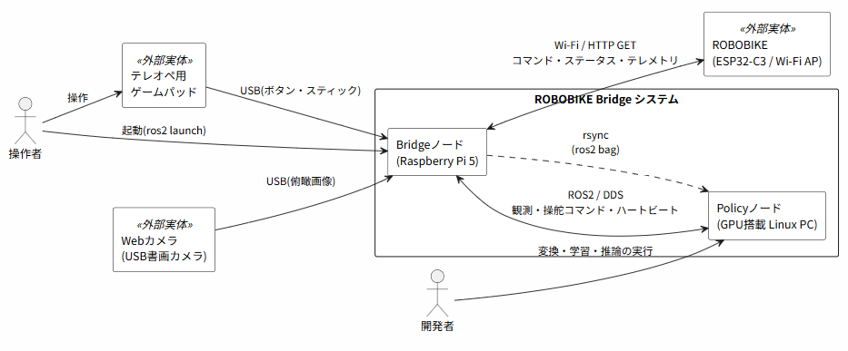

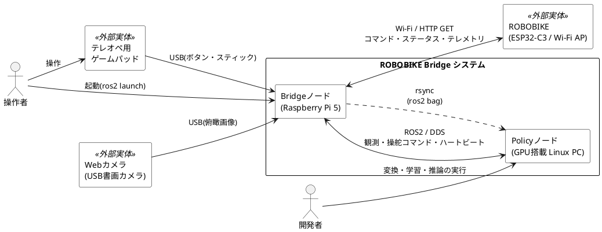

|要素|区分|役割|
|---|---|---|
|操作者|利用者|ゲームパッドで手動運転し、エピソードの開始/終了、方策の開始/停止、速度の操作を行う|
|開発者|利用者|データ変換・学習・推論ノードの起動を行う(本課題では操作者が兼ねる)|
|Webカメラ|外部実体|ROBOBIKE と走行コースを捉える固定の俯瞰カメラ。人が目視で操作するときの視界に相当する|
|ゲームパッド|外部実体|Xbox 互換ゲームパッド(Elecom JC-U4113S)。USB ドングルで Bridgeノードに接続|
|ROBOBIKE|外部実体|改変しない市販ロボット。HTTP API でコマンドを受け付け、ステータス・テレメトリを返す|
|Bridgeノード|システム内|ROS2 と ROBOBIKE の橋渡し(ゲートウェイ)。入力デバイスの接続とデータ記録|
|Policyノード|システム内|データ変換・方策学習・推論|

### 3.2. アーキテクチャ方針・選定理由

|方針|内容|選定理由|
|---|---|---|
|**ゲートウェイ(ブリッジ)構成**|ROBOBIKE 固有の HTTP API を Bridgeノードに閉じ込め、システム内部は ROS2 トピックで統一する|ROBOBIKE を改変せずに済む。方策側は ROBOBIKE の通信仕様を知らなくてよい。ダミーサーバへの差し替えも容易になる|
|**Publish/Subscribe(トピック駆動)**|ノードは単機能に分け、トピックで疎結合に接続する|入力源(ゲームパッド/方策)を差し替えても `sub_command` は変わらない。ros2 bag でそのまま記録できる|
|**エッジ/計算ノードの分離**|実機に近い処理(I/O・記録)は Pi、重い処理(学習・推論)は GPU PC に配置する|Pi では推論が間に合わない。記録を Pi で行うと、Wi-Fi 越しのフレーム欠落が学習データに混入しない|
|**データ収集・学習のオフライン分離**|記録は ros2 bag(生データ)、学習用データセットへの変換は後段のバッチ処理とする|記録時に方策の入出力定義を決めなくてよい。エピソードの取捨選択や再変換ができる|
|**入出力定義の一元化**|方策の状態・行動・正規化を `policy_features.py` に集約し、変換と推論で共用する|学習時と推論時で入力の意味がずれる不具合を防ぐ|
|**フェイルセーフ優先**|停止系コマンドは常に送信可能かつ最優先とし、ハートビート監視で異常時に停止する|二輪ロボットは転倒しやすく、通信途絶時に暴走しないことを最優先とする|

### 3.3. 技術スタック・要素技術

|区分|技術|用途・選定理由|
|---|---|---|
|OS|Ubuntu Desktop 26.04 LTS|ROS2 Lyrical Luth の対応 OS。Pi 5 と PC で共通化|
|ミドルウェア|ROS2 Lyrical Luth(rclpy)|講座で習得した技術。分散ノード間通信・記録(ros2 bag)・launch を提供|
|通信|DDS(ROS2 標準)、`ROS_DOMAIN_ID=10`|Pi と PC の間でトピックを自動発見して接続|
|言語|Python 3.14(ROS2)、Python 3.12(学習)|ROS2 と LeRobot の双方が Python を主に使う|
|ロボット通信|`urllib`(HTTP GET)|ROBOBIKE の API が HTTP GET ベースのため。追加依存なし|
|画像処理|OpenCV、cv_bridge|カメラ取得・縮小・JPEG エンコード/デコード|
|入力デバイス|pygame|ゲームパッドのボタン・スティックの読み取り|
|記録|rosbag2(MCAP)|トピックを記録時刻付きで保存。後から再生・変換できる|
|学習|LeRobot 0.6.1(ACT)、PyTorch、CUDA|講座で扱った模倣学習。行動チャンク予測により推論頻度を下げられる|
|パッケージ管理|colcon(ament_python)、uv|ROS2 パッケージのビルドと、venv の作成|
|テスト|pytest、ament_flake8 / pep257 / mypy / xmllint / copyright|`colcon test` で実行|
|テスト用サーバ|`http.server`(ThreadingHTTPServer)|ダミー ROBOBIKE の実装|

## 4. インフラ・ネットワークアーキテクチャ
### 4.1. インフラ構成図(物理/論理構成図)

すべてオンプレミス(家庭内)で構成し、クラウドサービスは使用しない。

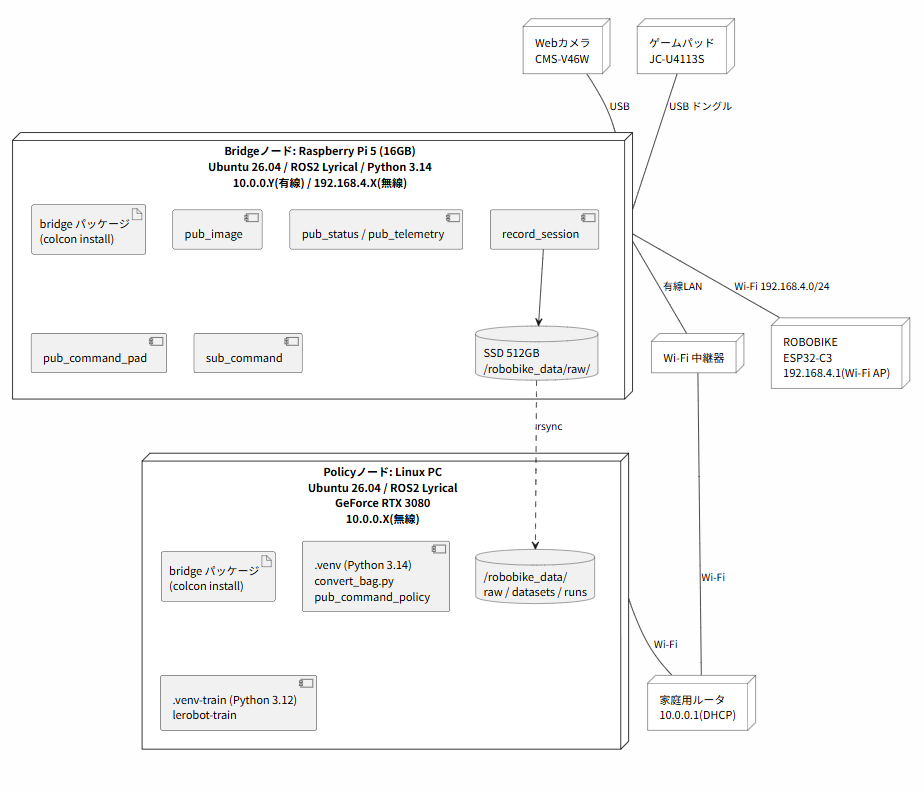

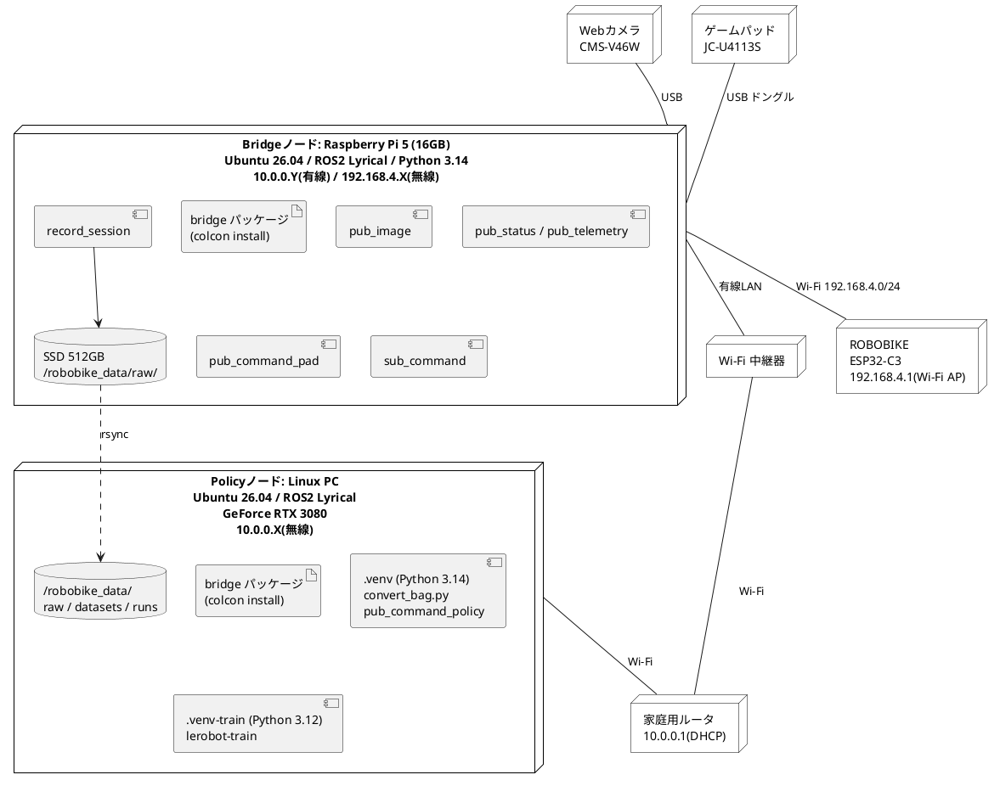

|ノード|ハードウェア|主なソフトウェア|
|---|---|---|
|Bridgeノード|Raspberry Pi 5 16GB、SSD 512GB|ROS2 Lyrical、OpenCV、pygame、`bridge` パッケージ|
|Policyノード|Linux PC、NVIDIA GeForce RTX 3080|ROS2 Lyrical、LeRobot 0.6.1、PyTorch(CUDA)、`bridge` パッケージ|
|ROBOBIKE|ESP32-C3-WROOM-02、MG90S/MG90D サーボ、Li-ion 14500|既存ファームウェア(改変なし)|

`bridge` パッケージは両ノードに同じものをインストールする。Pi では launch ファイルで I/O 系ノードを起動する。PC では `pub_command_policy` と、`convert_bag.py` が参照する `policy_features` を利用する。

### 4.2. ネットワーク設計

用途の異なる2系統の LAN を Bridgeノードで分離する。

|系統|アドレス|接続機器|用途|
|---|---|---|---|
|家庭内LAN|10.0.0.0/8(DHCP)、ゲートウェイ 10.0.0.1|Bridgeノード(中継器経由の有線)、Policyノード(無線)|ROS2/DDS 通信、インターネット(パッケージ更新・git)、rsync|
|ROBOBIKE LAN|192.168.4.0/24、ROBOBIKE が 192.168.4.1|Bridgeノード(無線)、ROBOBIKE|ROBOBIKE HTTP API|

- ROBOBIKE は自身が AP となる閉じたネットワークで、インターネットへは出られない。Bridgeノードは有線 NIC を家庭内LAN、無線 NIC を ROBOBIKE LAN に使い分ける
- ROS2 の通信範囲は `ROS_DOMAIN_ID=10` で限定する
- DNS・CDN・ロードバランサは使用しない
- 帯域は家庭内LANの無線区間(PC)が制約となるため、画像を圧縮し、画像とハートビートは BEST_EFFORT とする(7.2節)

### 4.3. バックアップ・DR(災害復旧)方針

冗長構成や DR は設けない。データの保全は次の方針とする。

|対象|保存場所|保全方法|
|---|---|---|
|ソースコード|GitHub([coolerking/robobike_bridge](https://github.com/coolerking/robobike_bridge))|git で管理|
|生データ(ros2 bag)|Pi の SSD → PC へ rsync|Pi と PC の2箇所に保持。追記型(`rsync -av`)で上書きしない|
|データセット・学習結果|PC の `~/robobike_data/datasets`、`runs`|生データから再生成できるため、バックアップは任意|

障害時は、Pi・PC とも [ROS2 セットアップ手順](./setup_ros2_on_rpi5.md) で環境を作り直し、GitHub から clone してビルドする。

## 5. アプリケーションアーキテクチャ
### 5.1. アプリケーション構造・レイヤー設計

`bridge` パッケージは次の3層に分ける。上位層は下位層だけに依存する。

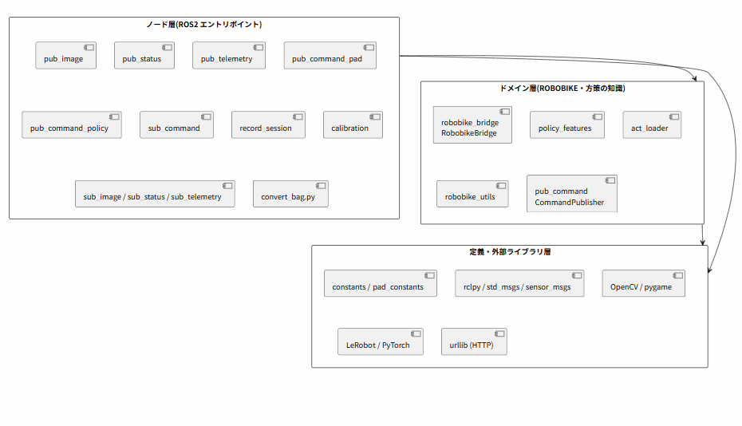

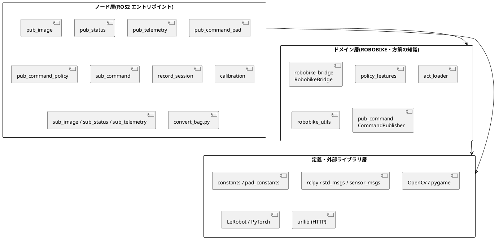

|層|責務|主なモジュール|
|---|---|---|
|ノード層|ROS2 ノードとしての起動・周期処理・トピック入出力・コマンドライン引数|`pub_*`、`sub_*`、`record_session`、`calibration`、`policy/convert_bag.py`|
|ドメイン層|ROBOBIKE API の呼び出しと CSV 解析、方策の入出力変換、モデル読み込み、コマンド配信の共通処理|`robobike_bridge`、`policy_features`、`act_loader`、`robobike_utils`、`pub_command`|
|定義・外部ライブラリ層|定数(トピック名・QoS・周期・閾値・コマンド表・CSV項目表)と外部ライブラリ|`constants`、`pad_constants`|

`policy_features` は torch に依存しない作りにしている。このため Pi でも import でき、変換スクリプトとも共用できる。torch への依存は `act_loader` と `pub_command_policy` の推論処理に限定している。

### 5.2. コンポーネント/モジュール構成

**ノード間の接続**

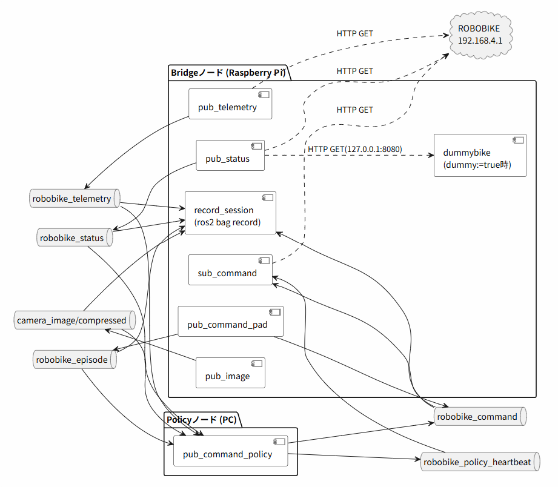

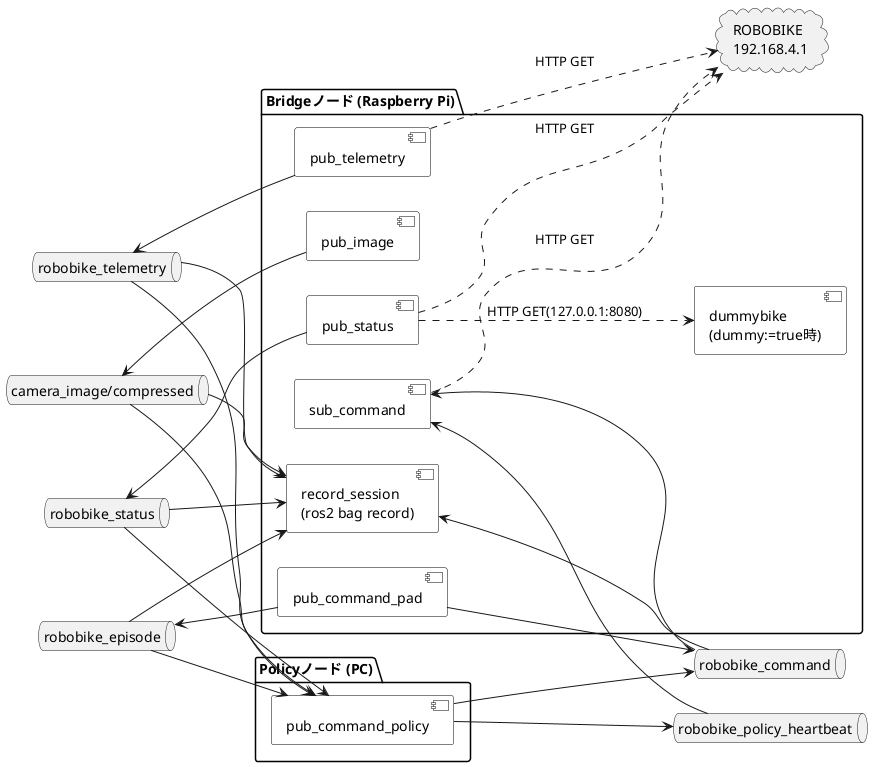

|コンポーネント|配置|役割|
|---|---|---|
|`pub_image`|Pi|カメラ画像を取得し、320x240 の JPEG に圧縮して10Hzで配信する(`--dummy` でダミー画像)|
|`pub_status`|Pi|`only_data` コマンドでステータスを取得し、JSON で配信する|
|`pub_telemetry`|Pi|`/get_acc` でテレメトリを取得し、直近100msを平均して JSON で配信する|
|`pub_command_pad`|Pi|ゲームパッド入力をコマンドに変換して配信する。START/BACK でエピソードイベントを配信する|
|`sub_command`|Pi|コマンドを受信し、送信キュー経由で ROBOBIKE に HTTP 送信する。`--watchdog` でハートビートを監視する|
|`record_session`|Pi|`ros2 bag record` を起動し、記録対象トピックを MCAP で保存する|
|`calibration`|Pi|走行前に `mot_spd` を目標値へ合わせる(ROS2 を介さず HTTP を直接呼ぶ)|
|`dummybike`|Pi/PC|ROBOBIKE の HTTP API を模したダミーサーバ(127.0.0.1:8080)|
|`sub_image` / `sub_status` / `sub_telemetry`|任意|動作確認用のモニタ(画像表示・ログ出力)|
|`pub_command_policy`|PC|観測を購読して ACT で推論し、操舵コマンドとハートビートを配信する|
|`convert_bag.py`|PC|ros2 bag を LeRobotDataset に変換する(ROS2 パッケージ外、`COLCON_IGNORE`)|
|`lerobot-train`|PC|LeRobot 標準の学習コマンド(本リポジトリ外)|

**主要クラス**

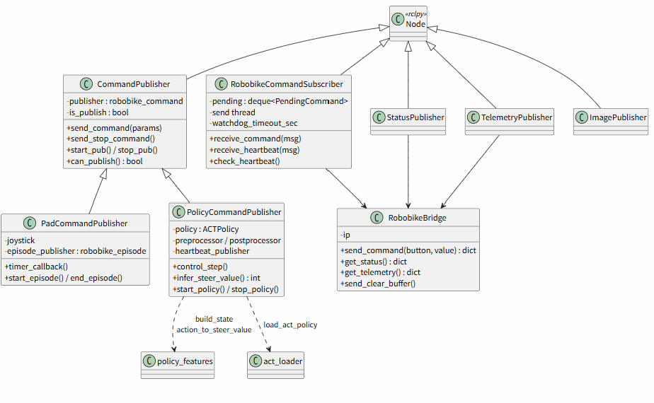

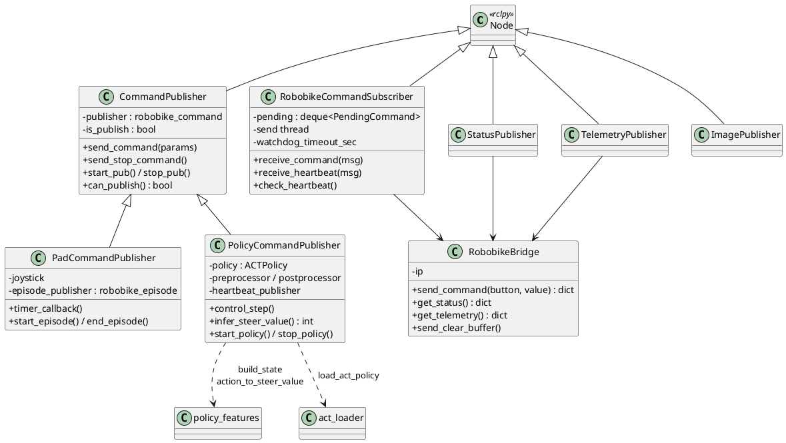

ゲームパッドと方策は、どちらも `CommandPublisher` を継承した「コマンドの発行元」である。`robobike_command` トピック上では区別しない。このため `sub_command` は入力源を意識せずに ROBOBIKE へ送信できる。

### 5.3. 共通基盤・フレームワーク設計

|共通処理|設計|
|---|---|
|設定・定数|トピック名、QoS、周期、閾値、ROBOBIKE コマンド表(37種)、CSV 項目表、保存先を `constants.py` に集約する。ゲームパッドのボタン・軸の割り当ては `pad_constants.py` に分ける|
|ログ出力|ROS2 ロガー(`get_logger()`)を使う。高頻度のログを出すノード(`pub_image` / `pub_status` / `pub_telemetry`)は `output='log'` で `~/.ros/log` に出力し、操作に関わるノードは画面に出す。繰り返す警告は間引く(`_warn_throttled`)|
|エラーハンドリング|HTTP 通信は1秒でタイムアウトし、失敗しても例外でノードを止めず、`status=error` の辞書を返してその周期をスキップする。CSV の項目数不一致・数値変換失敗・非有限値(NaN/∞)はエラーとして扱う。推論で例外が出た場合は行動列を破棄して次周期に再試行する|
|安全停止|`CommandPublisher.send_stop_command()` は Publish 停止中でも送信できる(停止方向の操作は常に許可)。停止系コマンド(`stp_all` / `bt_S` / `bt_D_St`)は未送信キューを破棄して最優先で送信する。ノード終了時(`destroy_node`)にも緊急停止を送る|
|並行処理|`sub_command` は HTTP 送信を受信コールバックとは別のスレッドで行う。キューの操作は `threading.Condition` で保護し、送信スレッドはキューが空の間待機する|
|モデル読み込み|`act_loader.load_act_policy()` が `config.json`・`model.safetensors`・前後処理の正規化統計を直接読み込む。draccus を使わないため Python 3.14 で動作する|
|トランザクション・セッション管理|該当なし(状態はノードのメモリ上にのみ持つ)|

**方策ノードの状態遷移**

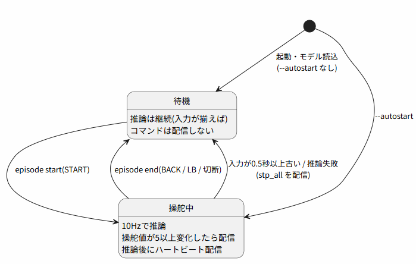

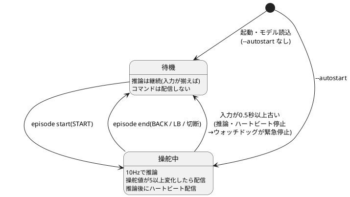

入力途絶で `待機` に戻ったあと、入力が復帰しても操舵は自動では再開しない。操作者が START を押して再開する。

## 6. データアーキテクチャ
### 6.1. データストア構成

RDB・NoSQL・キャッシュは使用しない。永続データはすべてファイルとして、`~/robobike_data`(環境変数 `ROBOBIKE_DATA_DIR` で変更可)以下に保存する。

|ディレクトリ|形式|作成元|配置|内容|
|---|---|---|---|---|
|`raw/<YYYYmmdd_HHMMSS>/`|ros2 bag(MCAP)|`record_session`|Pi(→ PC へ rsync)|1セッション分の記録対象トピック(未加工)|
|`datasets/<データセット名>/`|LeRobotDataset(Parquet・動画・`meta/info.json`)|`convert_bag.py`|PC|学習用データセット|
|`runs/<実行名>/`|LeRobot チェックポイント(`config.json`、`model.safetensors`、前後処理統計、`train_config.json`)|`lerobot-train`|PC|学習ログ・チェックポイント|
|`models/`|-|(予約)|PC|推論用に書き出したモデルの置き場(現状未使用)|

ROBOBIKE 側のステータス(設定値)は ROBOBIKE 本体が保持しており、本システムは読み取りと増減コマンドの送信のみを行う。

### 6.2. データモデル方針・概念設計

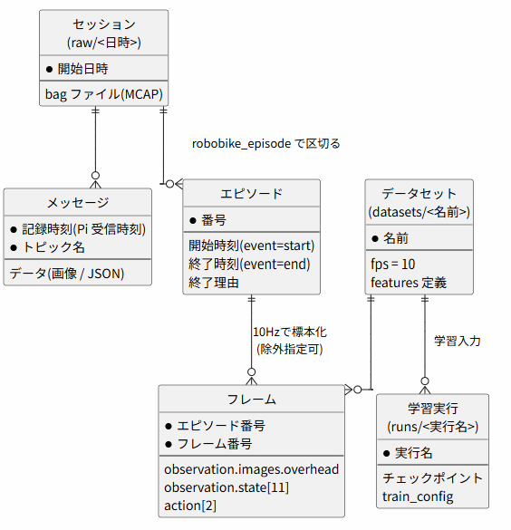

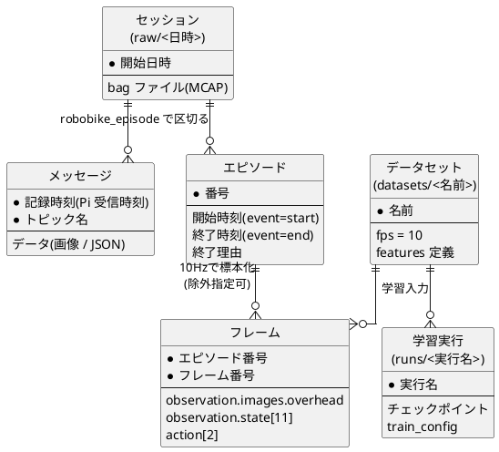

**方策の入出力(`policy_features.py`)**

|特徴量|形状|内容|
|---|---|---|
|`observation.images.overhead`|240x320x3(RGB、uint8)|俯瞰カメラ画像|
|`observation.state`|11(float32)|テレメトリ10項目(`drv`、`str`、`std`、`sv_pos`、`gy_roll`、`gy_yaw`、`gy_pitch`、`acc_x`、`acc_y`、`acc_z`)と、ステータス `mot_spd`|
|`action`|2(float32)|`steer`(`bt_Str_S` の value -100〜100 を -1.0〜1.0 に正規化)、`mot_spd`(推論時は不使用)|

`mot_spd` を行動に含めているのには2つの理由がある。LeRobotDataset が shape (1,) の特徴量をスカラーとして保存し、ACT で扱えなくなるのを避けるため。もう一つは将来の速度制御への拡張のためである。

### 6.3. データ整合性・永続化方針

- **時刻の基準**：トピックには Publish 時刻を持たせていない。このため、すべての記録を Pi 上の受信時刻(= bag の記録時刻)で揃える。記録を観測源と同じ Pi で行うのはこのためである
- **フレームの同期**：`convert_bag.py` は、エピソード区間を 10Hz の等間隔に区切る。各時刻について、それ以前の最新の画像・テレメトリ・ステータスと、それ以前に最後に送信された操舵値(未送信なら0)を対応付ける
- **欠損の扱い**：必要な観測が欠けるフレームは採用しない。古い観測には警告を出す。転倒などの不要なエピソードは `--exclude` で除外する
- **不変性**：生データ(bag)は変換で変更しない。データセットは何度でも生データから再生成できる
- **学習と推論の一貫性**：状態・行動の項目順と正規化を `policy_features.py` に一元化する。正規化統計はチェックポイントに保存したものを推論でも使う
- **既知の制約**：受信時刻での対応付けは、センサの取得時刻や、操作が実機に反映される時刻まで一致させるものではない

## 7. インテグレーション(外部連携・通信)アーキテクチャ
### 7.1. API設計方針

システム内部のインタフェースは ROS2 トピックに統一する。サービスやアクションは使わない。メッセージ型は標準型に限定し、独自の msg 定義は作らない(ビルドを ament_python のみで済ませるため)。

|トピック|型|ペイロード|発行元 → 購読先|QoS|
|---|---|---|---|---|
|`camera_image/compressed`|`sensor_msgs/CompressedImage`|JPEG(320x240、品質80)、frame_id=`overhead_camera`|`pub_image` → `pub_command_policy`、記録|BEST_EFFORT(sensor_data)|
|`robobike_status`|`std_msgs/String`|ステータスの JSON|`pub_status` → `pub_command_policy`、記録|depth=10(RELIABLE)|
|`robobike_telemetry`|`std_msgs/String`|テレメトリ(100ms平均)の JSON|`pub_telemetry` → `pub_command_policy`、記録|depth=10(RELIABLE)|
|`robobike_command`|`std_msgs/String`|`{"command_index": n, "value": v}`(value は `bt_Str_S` のみ)|`pub_command_pad`・`pub_command_policy` → `sub_command`、記録|depth=10(RELIABLE)|
|`robobike_episode`|`std_msgs/String`|`{"event": "start"\|"end", "reason": "..."}`|`pub_command_pad` → `pub_command_policy`、記録|depth=10(RELIABLE)|
|`robobike_policy_heartbeat`|`std_msgs/Header`|stamp、frame_id=ノード名|`pub_command_policy` → `sub_command`|BEST_EFFORT(sensor_data)|

- ステータス・テレメトリ・コマンドは、ROBOBIKE の項目をそのまま JSON にして `String` で運ぶ。項目の追加に強く、bag からの変換も容易になる
- コマンドは名前ではなく番号(`command_index`、1〜37)で運ぶ。名前との対応は `constants.ROBOBIKE_COMMAND_NAMES` と `robobike_utils` で変換する
- 操舵値は整数に丸め、-100〜100 に収める(`normalize_value`)

### 7.2. 非同期通信・メッセージング

メッセージキュー製品(Kafka など)は使用しない。非同期連携は ROS2 の Publish/Subscribe(DDS)で行う。

|設計項目|方針|
|---|---|
|QoS の使い分け|画像とハートビートは BEST_EFFORT とする。遅れて届く古いフレーム・ハートビートには価値がないため、再送しない。コマンド・ステータス・テレメトリ・エピソードは RELIABLE とする|
|コマンドの送信キュー|`sub_command` は受信したコマンドを未送信キューに入れ、送信スレッドで1件ずつ HTTP 送信する。HTTP 往復(約80ms)より速く届くコマンドを次の規則で整理する|
|キューの整理規則|停止系コマンドは未送信キューを破棄して先頭に入れる。値を持つコマンド(`bt_Str_S`)は未送信の同じコマンドを最新値で置き換える。その他は受信順に送る|
|再送|停止系コマンドの送信に失敗した場合のみ、最大3回まで再送する。新しい停止系コマンドが届いたら再送をやめてそちらを送る|
|ハートビート監視|最初のハートビートを受信してから監視を始める。0.5秒途絶えたら `stp_all` を送り、次のハートビートまで監視を止める。ゲームパッドのみで操作するときはハートビートが来ないため、何もしない|

**手動運転とデータ収集(UC05・UC11)**

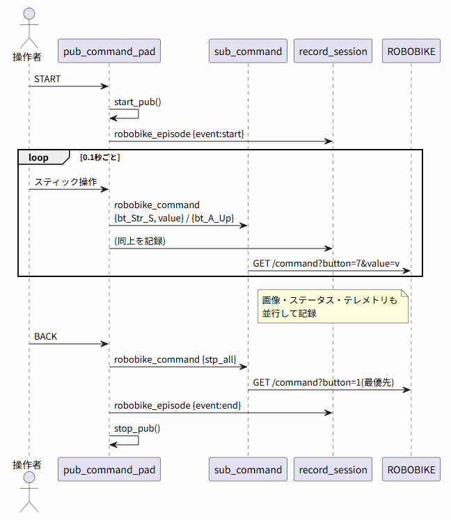

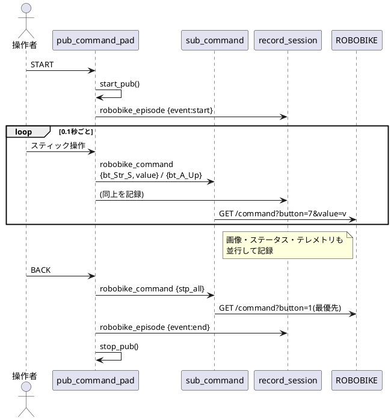

**方策による自動運転と異常時の停止(UC21)**

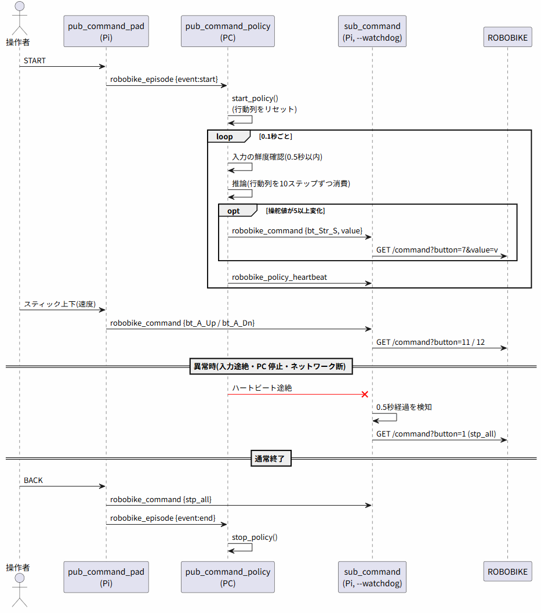

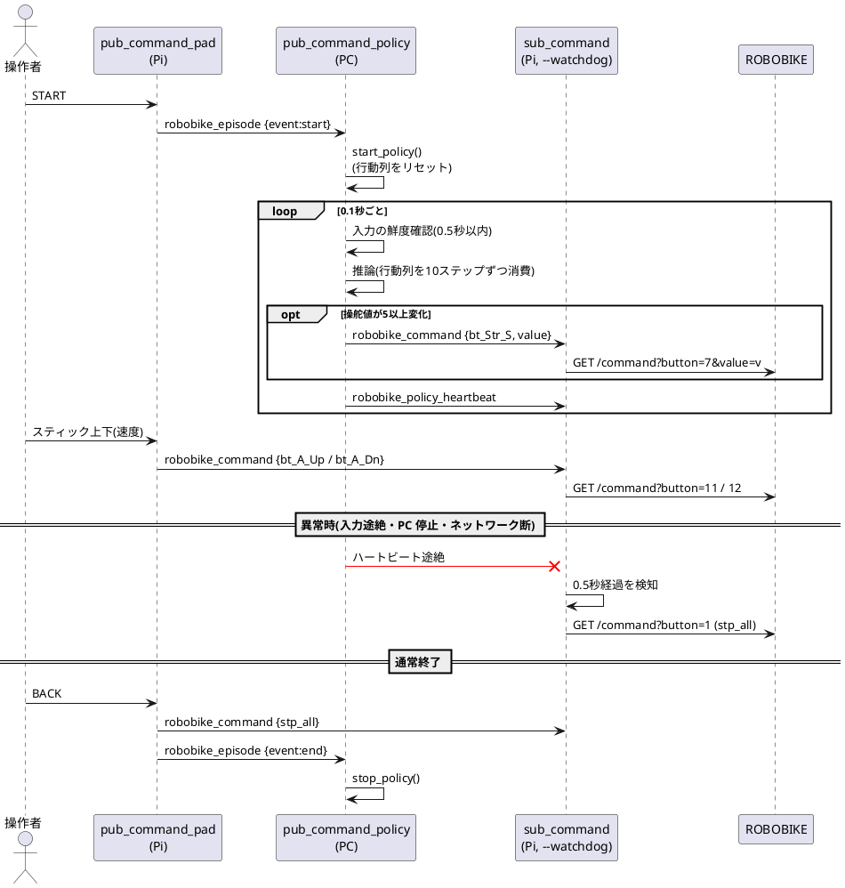

### 7.3. 外部システム連携

**ROBOBIKE HTTP API**

認証はない。すべて HTTP GET で、`RobobikeBridge` クラスに閉じ込めている。接続先は実機が `192.168.4.1`、ダミーが `127.0.0.1:8080`(`--dummy` で切り替え)。

|API|用途|応答|呼び出し元|
|---|---|---|---|
|`/command?button=<n>[&value=<v>]`|コマンド送信(n=1〜37、value は `bt_Str_S` のみ -100〜100)|ステータス CSV(先頭 `b`、17項目)|`sub_command`、`calibration`|
|`/command?button=2`(`only_data`)|ステータス取得(動作を伴わない)|ステータス CSV|`pub_status`|
|`/get_acc`|テレメトリ取得|テレメトリ CSV(先頭 `a`、13項目、複数行)|`pub_telemetry`|
|`/clear_buffer`|ROBOBIKE 側のテレメトリバッファ消去|-|(明示呼び出し時のみ)|

API の詳細は [ROBOBIKE 仕様 分析結果](./controller_map.md) を参照。

**ファイル連携(Pi → PC)**

|連携|方式|
|---|---|
|生データの転送|`rsync -av <user>@<Pi>:robobike_data/raw/ ~/robobike_data/raw/`(手動・バッチ)|
|学習結果の受け渡し|PC 内で完結(`runs/<実行名>/checkpoints/last/pretrained_model` を `--model` で指定)|

**ROS2 外の連携**

`calibration` は ROS2 を介さず、`RobobikeBridge` から直接 HTTP でステータスを読み、`bt_A_Up_0` / `bt_A_Dn_0` で `mot_spd` を目標値に合わせる。走行前の準備作業であり、他ノードとの同時実行は想定しない。

## 8. セキュリティアーキテクチャ

本システムは家庭内の閉じたネットワークで個人が使う研究用システムであり、外部公開しない。このため認証・暗号化は実装せず、次の前提とリスクを明記するにとどめる。

|観点|現状|前提・リスク|
|---|---|---|
|認証・認可|なし。ROS2(DDS)・ROBOBIKE API とも認証しない|同じネットワーク・同じ `ROS_DOMAIN_ID` の機器は、トピックの購読・コマンドの発行ができる。家庭内LANを信頼できる範囲とみなす|
|ネットワーク境界|家庭用ルータの NAT によりインターネットから遮断。ROBOBIKE LAN は Pi だけが接続する閉域網|ROBOBIKE の AP にはパスワードが設定されていない可能性がある(ファームウェア仕様に依存)|
|暗号化|なし(DDS 平文、HTTP 平文)|SROS2(DDS Security)は導入していない|
|機密情報|扱う個人情報・認証情報はない。俯瞰カメラ画像には撮影範囲の室内が写る|カメラの画角は走行コースに限定する。データセットは公開しない|
|物理的安全|8章の範囲外だが、実機の暴走防止を最重要とする|5.3節・7.2節のフェイルセーフで対処する|

外部公開や複数人での利用に拡張する場合は、SROS2 の導入と、ROBOBIKE LAN と家庭内LANの分離の維持を検討する(付録A)。

## 9. 運用・モニタリングアーキテクチャ
### 9.1. ログ・トレーサビリティ設計

|対象|出力先|内容|
|---|---|---|
|ノードのログ|画面、`~/.ros/log`|ROS2 ロガーによる送信コマンド・警告・エラー。高頻度ノードはファイルのみ|
|走行の記録|`~/robobike_data/raw/<日時>/`(ros2 bag)|学習用であると同時に、方策走行時(`watchdog:=true` でも記録される)の評価・事後解析に使う|
|学習の記録|`~/robobike_data/runs/<実行名>/`|`train_config.json`、`training_state/`、チェックポイント|

構造化ログや分散トレーシング(OpenTelemetry など)は導入しない。Pi のログは操作者が目視で確認し、必要に応じて開発環境へ書き写して共有する(Pi と開発環境のあいだに自動の収集経路はない)。

### 9.2. 監視・アラート設計

常時運用する監視基盤は持たない。走行中は操作者がその場で監視し、ソフトウェアは次の仕組みで異常を検知・停止する。

|監視対象|検知方法|対応|
|---|---|---|
|方策ノードの生存|ハートビート(10Hz)の途絶0.5秒|`sub_command` が緊急停止|
|方策入力の鮮度|画像・テレメトリ・ステータスの受信から0.5秒超|`pub_command_policy` が操舵を停止(ハートビート停止 → 緊急停止)|
|ゲームパッドの接続|pygame による接続確認(0.1秒周期)|緊急停止。GUIDE ボタンの点灯/点滅で接続状態を目視確認できる|
|ROBOBIKE との通信|HTTP タイムアウト(1秒)|警告ログ。その周期をスキップ|
|トピックの内容|`sub_image` / `sub_status` / `sub_telemetry`、`ros2 topic echo/hz`|開発者が手動で確認|

### 9.3. CI/CD・デプロイメント方針

CI サービスは使用しない。テストは開発者が手元で実行する。

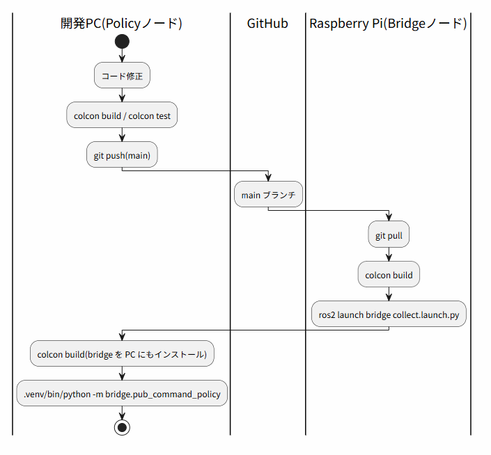

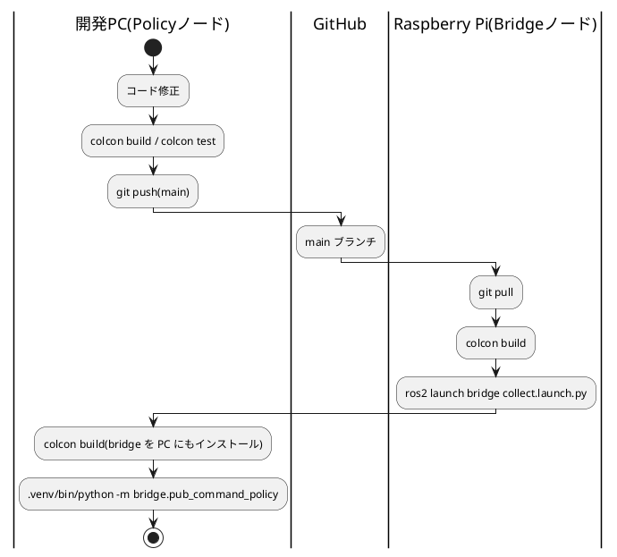

|項目|方針|
|---|---|
|ブランチ戦略|main ブランチのみ。Pi へのコード配布も main 経由に限る|
|ビルド|`colcon build`(ament_python)。`policy/`・`.venv`・`.venv-train` には `COLCON_IGNORE` を置き、ビルド対象から外す|
|テスト|`colcon test`。単体テスト(ステータス解析、テレメトリのウィンドウ平均、不完全な HTTP 応答、ユーティリティ)と、コードスタイル検査(flake8・pep257・mypy・xmllint・copyright)|
|デプロイ戦略|手動で `git pull` → `colcon build` → 再起動する(停止時間を許容)|
|モデルのデプロイ|学習済みチェックポイントのパスを `--model` で指定する。モデルはリポジトリで管理しない|
|事前確認|実機を使う前に `dummy:=true`(ダミー ROBOBIKE)、`dummy_camera:=true`(ダミー画像)、`--autostart`(ゲームパッドなし)で動作を確認する|

## 10. 付録・アーキテクチャ決定記録(ADR)
### 10.1. アーキテクチャ決定記録(ADR: Architecture Decision Records)

**ADR-01：ROBOBIKE を改変せず、HTTP API をブリッジする**

- 検討した選択肢：(a) ファームウェアを改変し ROS2(micro-ROS)を載せる、(b) 既存 HTTP API をブリッジする
- 決定：(b)
- 理由：ファームウェアのライセンスが明記されていない。市販品を「そのまま」使うことが課題の趣旨(既存システムへの Physical AI 適用)にも合う
- トレードオフ：制御周期が HTTP 往復時間(約80ms)に縛られる。センサのタイムスタンプが得られない

**ADR-02：推論を GPU 搭載 PC に分離する**

- 検討した選択肢：(a) Pi 5 上で推論、(b) PC で推論し ROS2/DDS で接続
- 決定：(b)
- 理由：Pi 5 では ACT の推論が10Hzに間に合わない
- トレードオフ：家庭内LANの遅延・途絶が制御ループに入る。このためハートビートとウォッチドッグ(ADR-06)が必要になった

**ADR-03：学習データは Pi で ros2 bag に記録し、後段で変換する**

- 検討した選択肢：(a) PC で直接 LeRobotDataset に記録、(b) Pi で ros2 bag(MCAP)に記録し PC で変換
- 決定：(b)
- 理由：Wi-Fi 越しのフレーム欠落を学習データに混入させないため。時刻を Pi の受信時刻に統一できる。エピソードの取捨選択や入出力定義の変更に再変換で対応できる
- トレードオフ：rsync と変換の手作業が増える

**ADR-04：方策の行動を [steer, mot_spd] とし、推論時は steer のみ使う**

- 検討した選択肢：(a) 行動を steer のみ、(b) [steer, mot_spd]、(c) 操舵と速度の両方を方策で制御
- 決定：(b)。速度は人が操作する
- 理由：shape (1,) の特徴量は LeRobotDataset でスカラー扱いとなり、ACT で扱えない。転倒しやすい機体で速度まで学習させるのは時期尚早であり、段階的に拡張する
- トレードオフ：方策の評価で速度条件を揃える必要がある

**ADR-05：学習と推論で venv を分け、独自ローダでモデルを読む**

- 検討した選択肢：(a) 全体を Python 3.12 に揃える、(b) 3.14(ROS2)と 3.12(学習)の2環境に分け、3.14 側は draccus を使わずにモデルを読む
- 決定：(b)
- 理由：ROS2 Lyrical はシステムの Python 3.14 に依存する。LeRobot の設定読み込みに使われる draccus は 3.14 に未対応
- トレードオフ：`act_loader.py` を LeRobot の更新に合わせて保守する必要がある

**ADR-06：ハートビート方式のウォッチドッグを Bridge 側に置く**

- 検討した選択肢：(a) 方策側だけで停止判断、(b) Bridge 側(`sub_command`)でハートビートを監視
- 決定：(b)。方策側の入力鮮度チェックと併用する
- 理由：PC のプロセス停止やネットワーク断では、方策側から停止コマンドを送れない。ROBOBIKE に最も近い Pi で判断する必要がある
- トレードオフ：Pi と ROBOBIKE 間の通信断には対応できない(ROBOBIKE 側の待機動作に依存)

**ADR-07：メッセージ型は標準型(String の JSON)にする**

- 検討した選択肢：(a) 独自 msg を定義、(b) `std_msgs/String` に JSON を載せる
- 決定：(b)
- 理由：ament_python のみでビルドでき、Pi・PC 間で msg パッケージを共有する手間がない。ROBOBIKE の CSV 項目をそのまま運べる
- トレードオフ：型チェックがなく、受信側で JSON の解析・検証が必要

**ADR-08：ROS2 の `policy` パッケージを廃止し、推論ノードを `bridge` に含める**

- 決定：未使用の雛形だった `src/policy` パッケージを削除し、推論ノード `pub_command_policy` を `bridge` パッケージに置く。変換スクリプトは ROS2 パッケージ外の `policy/` に置く
- 理由：推論ノードは `policy_features` や `CommandPublisher` など `bridge` の部品を共用するため、パッケージを分ける利点がない
- トレードオフ：Pi にも推論ノードのコードがインストールされる(LeRobot・torch はノード起動時に遅延 import するため、Pi で他のノードを動かすうえでの実害はない)

## A. 未決事項

|No.|事項|内容|
|---|---|---|
|A-1|時刻同期の精度|受信時刻による対応付けを、センサの取得時刻・コマンドの反映時刻まで考慮したものにするか。通信遅延と観測の時間差の計測が必要|
|A-2|行動列の実行ステップ数|`--n_action_steps`(デフォルト10 = 1秒)の最適値|
|A-3|速度制御への拡張|`mot_spd` を方策で制御する段階への移行条件と、そのときの安全機構|
|A-4|Pi–ROBOBIKE 間の通信断への対処|Wi-Fi 圏外で待機状態になる問題(電源の入れ直しが必要)への対策|
|A-5|評価方法|成功率、転倒までの走行時間、コース逸脱、介入回数などの定量評価の仕組み|
|A-6|セキュリティ強化|外部公開・複数人利用時の SROS2 導入|
|A-7|コードスタイル検査|`colcon test` の flake8・pep257・mypy の未対応指摘の解消|

## B. 備考

- 本システムは [Physical AI講座 応用編1](https://weblab.t.u-tokyo.ac.jp/lecture/course-list/physical-ai/advanced1/) の最終課題として構築した
- ROBOBIKE はモバイルロボット研究会の登録商標である
- 本書の PlantUML 図はソースのみを掲載している。画像化する場合は PlantUML の実行環境(VS Code 拡張など)を使用する

以上

