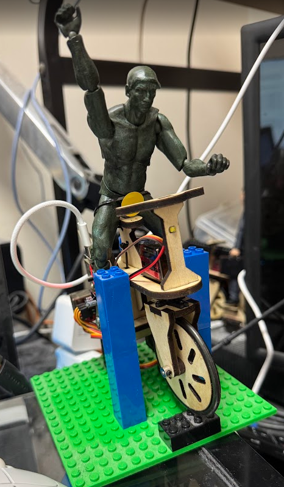
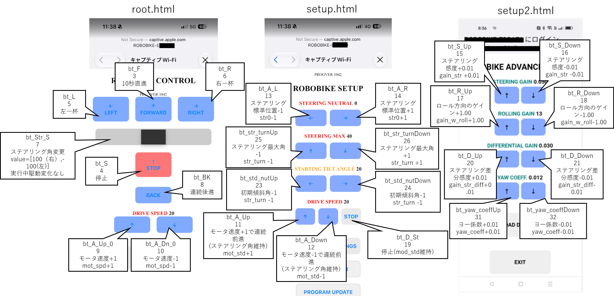

# Robobike 仕様 分析結果

保持しているROBOBIKEに対して、ロボットとしての仕様を分析した結果をまとめたものです。

- 調査日：2026/10/27

- ROBOBIKE テスト機 
    - PROGVER: 1042
    - DATAVER: 6

## MASTER ノード

ROBOBIKE に1台目としてWiFi接続すると接続ノードは MASTER になります。
MASTER ノードでブラウザを起動し、http://192.168.4.1 にアクセスすると、root.html が表示されます。
root.html からは setup.html、setup2.html へと遷移できます。

画面からROBOBIKEの操作、設定変更などが実行できます。

### 行動空間：command リスト

ROBOBIKEはHTTP GETを用いて、ROBOBIKEへコマンドを送信できます。

書式は `http://192.168.4.1/command&button=<button番号>` です。
ただし、一部コマンドは `http://192.168.4.1/command&button=<button番号>&value=<値>` のように value を指定する必要があります。

以下、実機に対して、curlコマンドを用いて調査した動作検証結果を表にまとめたものです。

| button | value | command(string) | 動作検証結果 |
|---|---|---|---|
| 1 | N/A | "stp_all" | Robobike 全停止 |
| 2 | N/A | "only_data" | データ取得のみ |
| 3 | N/A | "bt_F" | 10秒直進 |
| 4 | N/A | "bt_S" | 停止 |
| 5 | N/A | "bt_L" | 停止したまま左一杯 |
| 6 | N/A | "bt_R" | 停止したまま右一杯 |
| 7 | ステアリング値(int) (-100<最左>, 100<最右>) | "bt_Str_S" | ステアリング値を送信するコマンド |
| 8 | N/A | "bt_BK" | 連続後進 |
| 9 | N/A | "bt_A_Up_0" | モータ速度(mot_std)+1 |
| 10 | N/A | "bt_A_Dn_0" | モータ速度(mot_std)-1 |
| 11 | N/A | "bt_A_Up" | モータ速度(mot_std)+1で連続前進(ステアリング角維持) |
| 12 | N/A | "bt_A_Dn" | モータ速度(mot_std)-1で連続前進(ステアリング角維持) |
| 13 | N/A | "bt_A_L" | ステアリング標準位置(str0)-1 |
| 14 | N/A | "bt_A_R" | ステアリング標準位置(str0)+1 |
| 15 | N/A | "bt_S_Up" | ステアリング感度(gain_str)+0.01 |
| 16 | N/A | "bt_S_Dn" | ステアリング感度(gain_str)-0.01 |
| 17 | N/A | "bt_R_Up" | ロール方向のゲイン(gain_w_roll)+1.00 |
| 18 | N/A | "bt_R_Dn" | ロール方向のゲイン(gain_w_roll)-1.00 |
| 19 | N/A | "bt_D_St" | 停止(mod_spd維持) |
| 20 | N/A | "bt_D_Up" | ステアリング差分感度(gain_str_diff)+0.01 |
| 21 | N/A | "bt_D_Dn" | ステアリング差分感度(gain_str_diff)-0.01 |
| 22 | N/A | "bt_Std_nutAuto" | 初期傾斜角を標準位置に戻す(停止) |
| 23 | N/A | "bt_Std_nutUp" | 初期傾斜角(ang_str_nut)+1 |
| 24 | N/A | "bt_Std_nutDn" | 初期傾斜角(ang_str_nut)-1 |
| 25 | N/A | "bt_str_turnUp" | ステアリング最大角(str_turn)+1 |
| 26 | N/A | "bt_str_turnDn" | ステアリング最大角(str_turn)-1 |
| 27 | N/A | "bt_strcmd_Up" | ステアリングコマンド速度(str_cmd_speed)+1 |
| 28 | N/A | "bt_strcmd_Dn" | ステアリングコマンド速度(str_cmd_speed)-1 |
| 29 | N/A | "IR_ON" | 赤外線センサーON |
| 30 | N/A | "IR_OFF" | 赤外線センサーOFF |
| 31 | N/A | "bt_yaw_coeffUp" | ヨー係数(yaw_coeff)+0.01 |
| 32 | N/A | "bt_yaw_coeffDn" | ヨー係数(yaw_coeff)-0.01 |
| 33 | N/A | "bt_sweepON" | スイープ動作開始：ステアリングがだんだん激しく小刻みに動く→しばらく動いたら停止 |
| 34 | N/A | "bt_sweepOFF" | スイープ動作停止 |
| 35 | N/A | "bt_autoCirc_Up" | 自動旋回モードのゲイン(auto_circ_gain)を上げる+0.01 |
| 36 | N/A | "bt_autoCirc_Dn" | 自動旋回モードのゲイン(auto_circ_gain)を下げる-0.01 |
| 37 | N/A | "bt_Ld_Default" | ロードデフォルト設定 |

- button番号が1から開始することに注意してください
- ROBOBIKE は通信が一定時間ないと待機モードにはいり、電源スイッチOFF→ONしないと復帰しません（バッテリの消費を防ぐための仕様）
    - `curl http://192.168.4.1/command&button=2` を定期的に実行することで、ROBOBIKEの待機モード移行を防ぐことができます
- `curl http://192.168.4.1/command&button=1` を実行するとROBOBIKEが停止します（緊急停止に使用してください）

### 状態空間：command 戻り値

コマンド（`curl http://192.168.4.1/command&button=2`など）を送信した際のレスポンスとして以下の形式の `text/csv` 形式(UTF-8)のデータが返されます。

|番号|インデックス| デフォルト値 |動作検証結果 |
|---:|:---|---|:---|
| 0 | "b" | "b" | 固定、"b"が必ず返る |
| 1 | "PROGVER" | 1042 | Robobike実機プログラムのバージョン |
| 2 | "DATAVER" | 6 | Robobike実機プログラムの取り扱うデータのバージョン |
| 3 | "OK" | "OK" | コマンドが正常に実行されたかどうか、正常時"OK"が返る |
| 4 | "str0" | 0 | ステアリング角度の初期値 |
| 5 | "mot_spd" | 10 | モーター速度 |
| 6 | "gain_str" | 0.030 | ステアリングゲイン |
| 7 | "gain_w_roll" | 12.000 | ロール方向のゲイン |
| 8 | "gain_str_diff" | 0.030 | ステアリング差分ゲイン |
| 9 | "ang_std_nut" | 20 | 標準ナット角度 |
| 10 | "str_turn" | 40 | ステアリングターン角度 |
| 11 | "yaw_coeff" | 0.011 | ヨー係数 |
| 12 | "autoCircling" | 0 | 自動旋回モード、0か1 |
| 13 | "str_cmd_rate" | 0.000 | ステアリングコマンドレート |
| 14 | "str_cmd_speed" | 30 | ステアリングコマンド速度 |
| 15 | "auto_circ_gain" | 0.750 | 自動旋回ゲイン |
| 16 | "doSweep" | 0 | スイープ動作、0か1 |

- デフォルト値は、ROBOBIKEを最初にセットアップした時に返却されたCSV値です
- フィジカルAIでは、ステータス空間に相当します

## 非マスターノード

ROBOBIKEのWiFi APは最大2台まで接続可能で、２台目は非マスターノードとして動作します。
非マスターノードでブラウザを開くと、操作画面はでてこなくなりますが、commandの送信は可能です。

### （行動＋）観測空間： get_acc 戻り値

2台目を接続して `http:/192.168.4.1/` にアクセスすると、`monitor.html` が表示され、このCSVデータをリアルタイム（直近40行）で確認できます。

コマンド`curl http://192.168.4.1/get_acc` を送信した際のレスポンスとして以下の形式の `text/csv` 形式(UTF-8)のデータが返されますが、これはマスター・非マスターどちらでも実行可能です。

以下、get_acc の戻り値の詳細です。

|番号|インデックス| Web UIインデックス | デフォルト値 |動作検証結果 |
|---:|:---|:---|---|:---|
| 0 | "a" | HEADER | "a" | ヘッダ、固定文字 |
| 1 | "time" | TIME_MS | 54330 | `millis()` タイムスタンプ(実機上) |
| 2 | "drv" | SV_DRV | 0.000 | モータ出力 `mot_out` |
| 3 | "str" | SV_STR | 0.000 | ステアリング出力 `str_out` |
| 4 | "std" | SV_STD | 36.000 | スタンド出力 `ex1_out` |
| 5 | "swp_sg" | SWP_SG | 0.000 | スイープ信号 `swp_sg` |
| 6 | "sv_pos" | SV_POS | -62.007 | サーボ位置 (ADC値→角度変換、-90〜+90) |
| 7 | "gy_roll" | GY_ROLL | -0.021 | ジャイロロール角速度 |
| 8 | "gy_yaw" | GY_YAW | 0.107 | ジャイロヨー角速度 |
| 9 | "gy_pitch" | GY_PITCH | 0.215 | ジャイロピッチ角速度 |
| 10 | "acc_x" | ACC_X | -0.742 | 加速度センサーX軸 |
| 11 | "acc_y" | ACC_Y | -1.292 | 加速度センサーY軸 |
| 12 | "acc_z" | ACC_Z | -9.663 | 加速度センサーZ軸 |

- `curl http://192.168.4.1/clear_buffer` を実行すると、ROBOBIKEのセンサーバッファがクリアされます
- IMU値（ジャイロ・加速度）は Tvector6d acc 経由で ICM-426xx から取得され、AC_SENSITIVITY/GY_SENSITIVITY で物理量に変換済みです
- `curl http://192.168.4.1/get_acc` を実行したサンプルはこちら（803行のデータが返却されました）

以上
