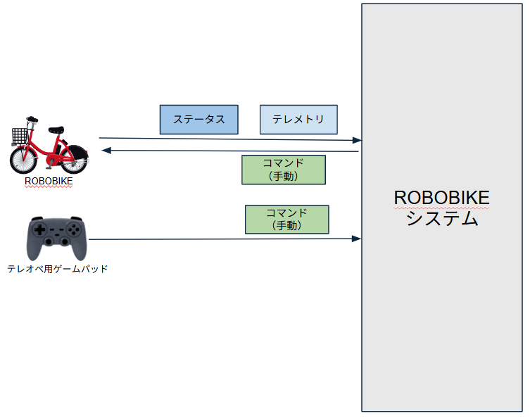
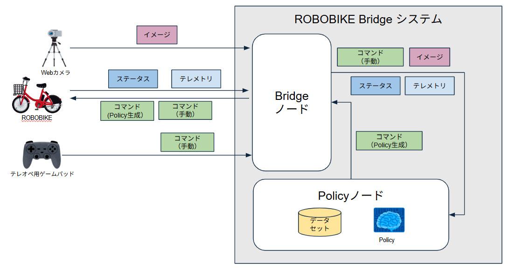

# ROBOBIKEシステムの自律走行化

フィジカルAI講座2026応用編1の最終課題として「ROBOBIKE Bridgeシステム」を構築した。

## 1. 基本課題 (XYZ分析)

- Z:(目的)～するために
    - 既存のシステムへのフィジカルAI技術適用することを理解するために
- Y:(手段)～することで
    - 市販のロボットにフィジカルAI研修で習得した知識（ROS2/模倣学習など）を適用したシステムを設計・構築することで
- Z:(活動)～をおこなう
    - フィジカルAI技術適用に必要な体系的な知識の裏付けをおこなう

## 2. システムコンテキストダイヤグラム

「市販のロボットにフィジカルAI研修で習得した知識を適用したシステム」として、市販のROBOBIKE（ROBOBIKEシステムと呼称）にフィジカルAI技術を適用して自律走行化を行うシステム『ROBOBIKE Brigde システム」を構築する

### 2.1 ベースシステム「ROBOBIKEシステム」構成

以下、ベースとしたROBOBIKEのシステム構成およびコンテキストダイヤグラムである。

|種類|名称|説明|
|---|---|---|
|プロセス|ROBOBIKEシステム|2輪走行ロボットをスマホをコントローラとして手動で操作するシステム|
|外部実体|コントローラ(Web操作画面)|スマートフォン、ROBOBIKE上で動作しているWi-Fi APに接続して、http://192.168.4.1/ を開くと、操作画面が表示される。これを操作することでROBOBIKEを動かす|
|外部実体|ROBOBIKE|市販の2輪走行するロボット自転車、バッテリを搭載しており無線で操作できる。電源をいれるとESP32-C2ベースのコンピュータユニットがWi-Fi APとして動作し、外部からのアクセスを許可する。|
|データストア|コマンド(手動)|スマホから送信されるROBOBIKEに対しての操作命令|
|データストア|ステータス|取得時のROBOBIKEが保持しているパラーメータ群(モータ速度初期値、ステアリング角の初期値、ステアリング感度など)|
|データストア|テレメトリ|取得時のROBOBIKEの観測データ群(IMUによる計測値、モータの状態など)|

### 2.2 システム化対象システム「ROBOBIKE Bridge システム」構成

既存システムであるROBOBIKEシステムを調査してどのようなデータストアを用いているのか、その内容についてなどを分析し、ROBOBIKE Bridgeシステムの構成を以下のように設計した。

ベースシステムのソフトウェアおよびハードウェアは改変無しでそのまま利用し、かつ自動走行を実現するシステムとして設計をおこなった。

|種類|名称|説明|
|---|---|---|
|プロセス|**ROBOBIKE Bridgeシステム**|2輪走行ロボットを模倣学習済み方策(Policy)をつかって操作するシステムを構築・運用する|
|プロセス|**Bridgeノード**|**ROBOBIKE Bridgeシステム**の１つの機能ブロック。二輪車をリモート操作する機能と自動運転を実現するための機能の橋渡しをする。システム的にもゲートウェイの位置づけで設計。|
|プロセス|**Policyノード**|**ROBOBIKE Bridgeシステム**の１つの機能ブロック。コマンド(手動)とステータス、テレメトリにくわえ資格情報としてのイメージを用いて方策を構築し運用する。|
|外部実体|**Webカメラ**|人がROBOBIKEを操作するとき、ROBOBIKEを視界に入れながら操作を行う。Webカメラは視界に相当するデータを収集するために導入する。|
|外部実体|**テレオペ用ゲームパッド**|Bridgeノード経由で操作をおこなうため、既存のs府作用Webサイトは使用できないために新規機能として設計。テレオペによる実機操作が可能であると同時に学習用データの保存も可能にしている。|
|外部実体|ROBOBIKE|市販の2輪走行するロボット自転車、バッテリを搭載しており無線で操作できる。電源をいれるとESP32-C2ベースのコンピュータユニットがWi-Fi APとして動作し、外部からのアクセスを許可する。今回はスマートフォンの代わりにBridgeノードがこのAPを使用する。|
|データストア|コマンド(手動)|スマホから送信されるROBOBIKEに対しての操作命令|
|データストア|**コマンド(Policy作成)|PolicyノードからACTが生成したROBOBIKEに対しての操作命令|
|データストア|ステータス|取得時のROBOBIKEが保持しているパラーメータ群(モータ速度初期値、ステアリング角の初期値、ステアリング感度など)|
|データストア|テレメトリ|取得時のROBOBIKEの観測データ群(IMUによる計測値、モータの状態など)|
|

## リファレンス

- [ROBOBIKE Bridge GitHubリポジトリ](https://github.com/coolerking/robobike_bridge.git)
- [最終課題提出用Youtube動画](https://youtu.be/iRC0z24Np8g)
- [ROBOBIKE](https://robobikejp.com/)

以上
