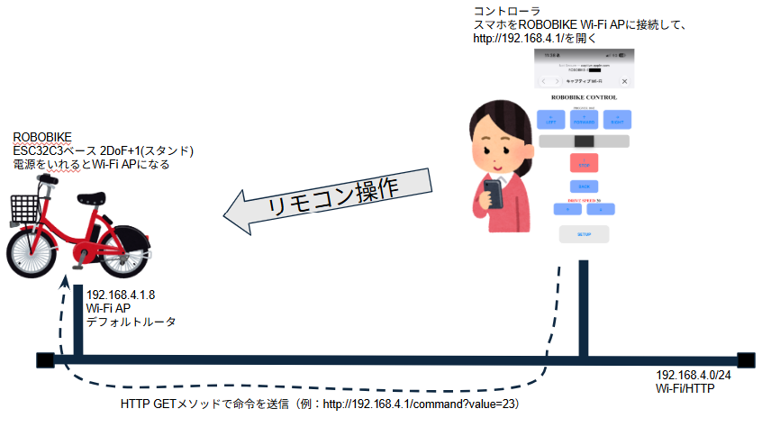
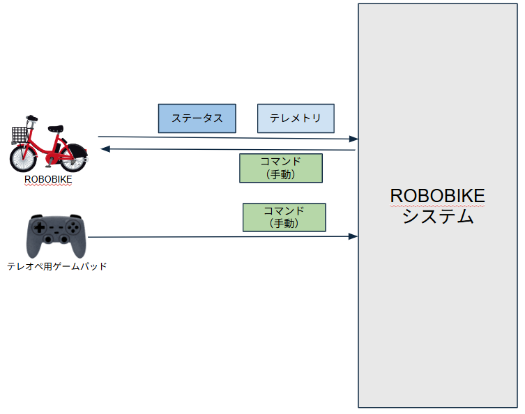
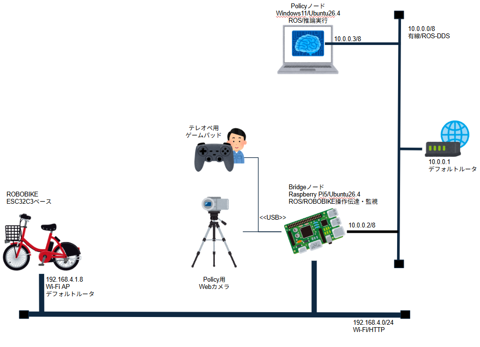
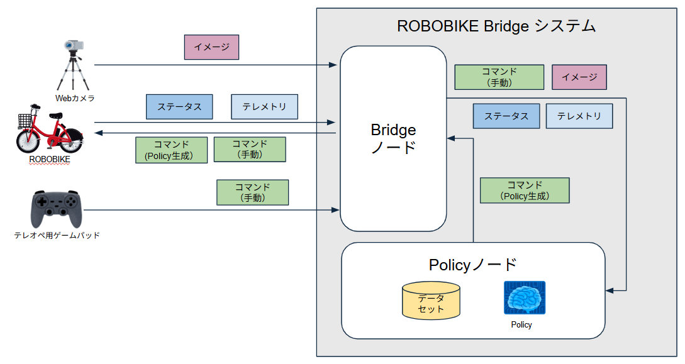
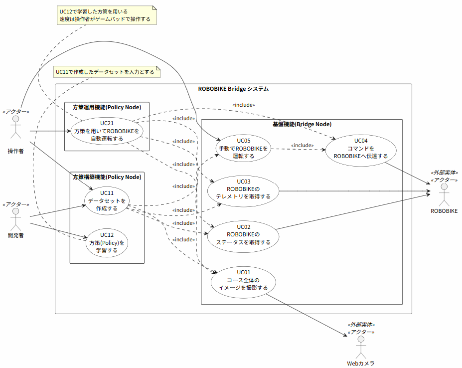
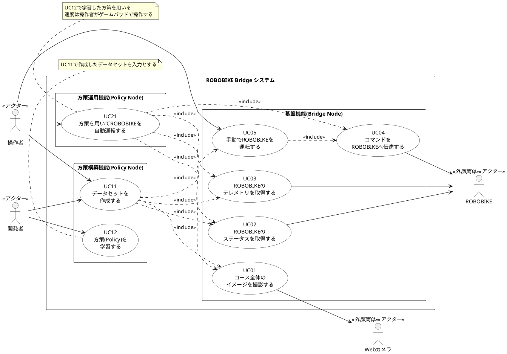

# 要件定義「ROBOBIKE Bridgeシステム」

フィジカルAI講座2026応用編1の最終課題として「ROBOBIKE Bridgeシステム」を構築した。

## 1. 基本課題 (XYZ分析)

- Z:(目的)～するために
    - 既存のシステムへのフィジカルAI技術適用することを理解するために
- Y:(手段)～することで
    - 市販のロボットにフィジカルAI研修で習得した知識（ROS2/模倣学習など）を適用したシステムを設計・構築することで
- Z:(活動)～をおこなう
    - フィジカルAI技術適用に必要な体系的な知識の裏付けをおこなう

## 2. システムコンテキストダイヤグラム

「市販のロボットにフィジカルAI研修で習得した知識を適用したシステム」として、市販のROBOBIKE（ROBOBIKEシステムと呼称）にフィジカルAI技術を適用して自律走行化を行うシステム『ROBOBIKE Bridge システム」を構築する

### 2.1 ベースシステム「ROBOBIKEシステム」構成

以下、ベースとしたROBOBIKEのシステム構成およびコンテキストダイヤグラムである。

|種類|名称|説明|
|---|---|---|
|プロセス|ROBOBIKEシステム|2輪走行ロボットをスマホをコントローラとして手動で操作するシステム|
|外部実体|コントローラ(Web操作画面)|スマートフォン、ROBOBIKE上で動作しているWi-Fi APに接続して、http://192.168.4.1/ を開くと、操作画面が表示される。これを操作することでROBOBIKEを動かす|
|外部実体|ROBOBIKE|市販の2輪走行するロボット自転車、バッテリを搭載しており無線で操作できる。電源をいれるとESP32-C3ベースのコンピュータユニットがWi-Fi APとして動作し、外部からのアクセスを許可する。|
|データストア|コマンド(手動)|スマホから送信されるROBOBIKEに対しての操作命令|
|データストア|ステータス|取得時のROBOBIKEが保持しているパラメータ群(モータ速度初期値、ステアリング角の初期値、ステアリング感度など)|
|データストア|テレメトリ|取得時のROBOBIKEの観測データ群(IMUによる計測値、モータの状態など)|

### 2.2 システム化対象システム「ROBOBIKE Bridge システム」構成

既存システムであるROBOBIKEシステムを調査してどのようなデータストアを用いているのか、その内容についてなどを分析し、ROBOBIKE Bridgeシステムの構成を以下のように設計した。

ベースシステムのソフトウェアおよびハードウェアは改変無しでそのまま利用し、かつ自動走行を実現するシステムとして設計をおこなった。

|種類|名称|説明|
|---|---|---|
|プロセス|**ROBOBIKE Bridgeシステム**|2輪走行ロボットを模倣学習済み方策(Policy)をつかって操作するシステムを構築・運用する|
|プロセス|**Bridgeノード**|**ROBOBIKE Bridgeシステム**の１つの機能ブロック。二輪車をリモート操作する機能と自動運転を実現するための機能の橋渡しをする。システム的にもゲートウェイの位置づけで設計。|
|プロセス|**Policyノード**|**ROBOBIKE Bridgeシステム**の１つの機能ブロック。コマンド(手動)とステータス、テレメトリにくわえ視覚情報としてのイメージを用いて方策を構築し運用する。|
|外部実体|**Webカメラ**|人がROBOBIKEを操作するとき、ROBOBIKEを視界に入れながら操作を行う。Webカメラは視界に相当するデータを収集するために導入する。|
|外部実体|**テレオペ用ゲームパッド**|Bridgeノード経由で操作をおこなうため、既存の操作用Webサイトは使用できないために新規機能として設計。テレオペによる実機操作が可能であると同時に学習用データの保存も可能にしている。|
|外部実体|ROBOBIKE|市販の2輪走行するロボット自転車、バッテリを搭載しており無線で操作できる。電源をいれるとESP32-C3ベースのコンピュータユニットがWi-Fi APとして動作し、外部からのアクセスを許可する。今回はスマートフォンの代わりにBridgeノードがこのAPを使用する。|
|データストア|コマンド(手動)|スマホから送信されるROBOBIKEに対しての操作命令|
|データストア|**コマンド(Policy作成)**|PolicyノードからACTが生成したROBOBIKEに対しての操作命令|
|データストア|ステータス|取得時のROBOBIKEが保持しているパラメータ群(モータ速度初期値、ステアリング角の初期値、ステアリング感度など)|
|データストア|テレメトリ|取得時のROBOBIKEの観測データ群(IMUによる計測値、モータの状態など)|
|データストア|イメージ|ROBOBIKEおよびROBOBIKEが走行する範囲を画角に捉えた固定カメラ画像 |

# 3. ユースケース

システム化対象を、以下の範囲とする。

- システム化対象は、2章で設計した「ROBOBIKE Bridge システム」(Bridgeノード、Policyノード)とする
- ROBOBIKE本体(ファームウェアを含む)とWebカメラは改変しない既存の外部実体として扱い、システム境界の外に置く
- ユースケースは次の3つのグループに分ける
    - UC0x：基盤機能(ROBOBIKEとのデータ・コマンドのやりとり、手動運転)
    - UC1x：方策構築機能(学習データの収集・変換、方策の学習)
    - UC2x：方策運用機能(学習済み方策による自動運転)

### 3.1 PlantUML：ユースケース図

|種類|名称|説明|
|---|---|---|
|アクター|操作者|テレオペ用ゲームパッドでROBOBIKEを操作する人。学習データ収集時のエピソード開始/終了、自動運転時の方策の開始/停止と速度操作も行う|
|アクター|開発者|収集したデータの変換、方策の学習をPolicyノード(PC)上で行う人。本課題では操作者と同一人物が兼ねる|
|アクター(外部実体)|Webカメラ|ROBOBIKEと走行コースを画角に捉える固定の俯瞰カメラ(Bridgeノードに USB 接続)|
|アクター(外部実体)|ROBOBIKE|Wi-Fi AP(192.168.4.1)として動作し、HTTP GET でステータス・テレメトリの取得とコマンドの受付を行う市販ロボット|

## 3.2 ユースケース記述

### 3.2.1 UC01：コース全体のイメージを撮影する

|項目|内容|
|---|---|
|概要|Webカメラでコース全体とROBOBIKEを撮影し、イメージとして配信する|
|アクター|Webカメラ|
|実行場所|Bridgeノード(`pub_image`)|
|事前条件|WebカメラがBridgeノードに接続されている|
|事後条件|イメージが`camera_image/compressed`トピックに配信されている|
|トリガー|Bridgeノードの起動(`collect.launch.py`)|

**基本フロー**

1. システムは、Webカメラから画像を1フレーム取得する
2. システムは、画像を 320x240 に縮小し、JPEG(品質80)に圧縮する
3. システムは、圧縮したイメージを`camera_image/compressed`トピックへ配信する
4. システムは、0.1秒(10Hz)ごとに1〜3を繰り返す

**代替・例外フロー**

- 1a. 画像を取得できない場合、システムはそのフレームを配信せず、次の周期で再取得する
- 3a. Wi-Fi越しの配信でフレームが欠落しても再送はせず、次のフレームを待つ(BEST_EFFORT)

### 3.2.2 UC02：ROBOBIKEのステータスを取得する

|項目|内容|
|---|---|
|概要|ROBOBIKEが保持するパラメータ群(ステータス)を取得し、配信する|
|アクター|ROBOBIKE|
|実行場所|Bridgeノード(`pub_status`)|
|事前条件|BridgeノードがROBOBIKEのWi-Fi APに接続されている|
|事後条件|ステータスが`robobike_status`トピックに配信されている|
|トリガー|Bridgeノードの起動|

**基本フロー**

1. システムは、ROBOBIKEへHTTP GETでステータスを要求する
2. ROBOBIKEは、ステータス(モータ速度`mot_spd`、ステアリング標準位置、ステアリング感度など)を返す
3. システムは、受信したステータスを`robobike_status`トピックへ配信する
4. システムは、一定周期(デフォルト0.05秒)ごとに1〜3を繰り返す

**代替・例外フロー**

- 2a. 1秒以内に応答がない場合、システムはその周期の配信を行わず、次の周期で再要求する
- 2b. ROBOBIKEがWi-Fi範囲外に出て待機状態になった場合、取得は再開できない(ROBOBIKEの電源入れ直しが必要)

### 3.2.3 UC03：ROBOBIKEのテレメトリを取得する

|項目|内容|
|---|---|
|概要|ROBOBIKEの観測データ群(テレメトリ)を取得し、配信する|
|アクター|ROBOBIKE|
|実行場所|Bridgeノード(`pub_telemetry`)|
|事前条件|BridgeノードがROBOBIKEのWi-Fi APに接続されている|
|事後条件|テレメトリが`robobike_telemetry`トピックに配信されている|
|トリガー|Bridgeノードの起動|

**基本フロー**

1. システムは、ROBOBIKEへHTTP GET(`get_acc`)でテレメトリを要求する
2. ROBOBIKEは、テレメトリ(駆動・操舵の状態、サーボ位置、IMUのジャイロ・加速度など)を返す
3. システムは、直近100ミリ秒分の値を平均化する
4. システムは、平均化したテレメトリを`robobike_telemetry`トピックへ配信する
5. システムは、一定周期(デフォルト0.05秒)ごとに1〜4を繰り返す

**代替・例外フロー**

- 2a. 1秒以内に応答がない場合、システムはその周期の配信を行わず、次の周期で再要求する
- 2b. ROBOBIKEが待機状態になった場合、UC02の2bと同様

### 3.2.4 UC04：コマンドをROBOBIKEへ伝達する

|項目|内容|
|---|---|
|概要|`robobike_command`トピックで受け取ったコマンドを、ROBOBIKEのHTTP APIに変換して送信する|
|アクター|ROBOBIKE|
|実行場所|Bridgeノード(`sub_command`)|
|事前条件|BridgeノードがROBOBIKEのWi-Fi APに接続されている|
|事後条件|ROBOBIKEがコマンドに従って動作している|
|トリガー|`robobike_command`トピックの受信(UC05、UC21から)|

**基本フロー**

1. システムは、`robobike_command`トピックからコマンド(コマンド名と値)を受信する
2. システムは、コマンドを未送信キューに入れる
    - 停止系コマンドの場合：未送信のコマンドをすべて破棄し、最優先で送信する
    - 値を持つコマンド(操舵`bt_Str_S`など)の場合：未送信の同じコマンドを最新の値で置き換える
    - その他の場合：受信順に並べる
3. システムは、送信スレッドでキューの先頭のコマンドを`http://192.168.4.1/command?button=<番号>[&value=<値>]`として送信する
4. ROBOBIKEは、コマンドに従って動作する

**代替・例外フロー**

- 3a. 停止系コマンドの送信に失敗した場合、システムは規定回数まで再送する(新しい停止系コマンドが届いた場合はそちらを送信する)
- 1a. (ウォッチドッグ有効時)方策のハートビートが0.5秒途絶えた場合、システムは緊急停止コマンド(`stp_all`)を送信し、次のハートビートを受信するまで監視を止める

### 3.2.5 UC05：手動でROBOBIKEを運転する

|項目|内容|
|---|---|
|概要|操作者がテレオペ用ゲームパッドでROBOBIKEを運転する|
|アクター|操作者|
|実行場所|Bridgeノード(`pub_command_pad`)|
|事前条件|ゲームパッドがBridgeノードに接続されている。UC04が動作している|
|事後条件|ROBOBIKEが操作者の操作どおりに走行している|
|インクルード|UC04|

**基本フロー**

1. 操作者は、RB(またはSTART)を押してコマンド送信を開始する
2. 操作者は、ROBOBIKEを目視しながらスティックを操作する
3. システムは、スティックの左右を操舵コマンド(`bt_Str_S`)、上下を速度増減コマンド(`bt_A_Up`/`bt_A_Dn`)に変換し、`robobike_command`トピックへ配信する
4. システムは、UC04でコマンドをROBOBIKEへ伝達する
5. 操作者は、LB(またはBACK)を押してコマンド送信を停止する
6. システムは、緊急停止コマンドを配信し、ROBOBIKEを停止させる

**代替・例外フロー**

- 2a. 操作者がB、GUIDE、LT/RTを押した場合、システムは緊急停止コマンド(`stp_all`)を配信する
- 3a. スティックの変化量がしきい値未満の場合、システムはコマンドを配信しない(通信量の抑制)
- 2b. ゲームパッドが切断された場合、システムは緊急停止コマンドを配信してコマンド送信を停止する(再接続後はSTART/RBを押すまで送信しない)

### 3.2.6 UC11：データセットを作成する

|項目|内容|
|---|---|
|概要|手動運転中のイメージ・ステータス・テレメトリ・コマンドを記録し、学習用データセット(LeRobotDataset)に変換する|
|アクター|操作者、開発者|
|実行場所|Bridgeノード(記録：`record_session`)、Policyノード(変換：`policy/convert_bag.py`)|
|事前条件|UC01〜UC04が動作している。必要に応じて`calibration`でモータ速度(`mot_spd`)を調整済み|
|事後条件|`~/robobike_data/datasets/<データセット名>/`にデータセットが保存されている|
|インクルード|UC01、UC02、UC03、UC05|

**基本フロー**

1. 操作者は、`ros2 launch bridge collect.launch.py`でBridgeノードを起動する
2. システムは、記録対象トピックをros2 bag(mcap)として`~/robobike_data/raw/<日時>/`に記録し始める
3. 操作者は、STARTを押してエピソードを開始する
4. システムは、エピソード開始イベントを`robobike_episode`トピックへ配信する
5. 操作者は、UC05で目標の走行を行う
6. 操作者は、BACKを押してエピソードを終了する
7. システムは、緊急停止コマンドとエピソード終了イベントを配信する
8. 操作者は、3〜7を必要なエピソード数だけ繰り返したのち、Ctrl+Cで記録を終了する
9. 開発者は、記録したbagをPolicyノードへコピー(rsync)する
10. 開発者は、`convert_bag.py --list`でエピソード一覧を確認する
11. 開発者は、除外するエピソードを指定して`convert_bag.py`を実行する
12. システムは、エピソードごとにイメージ・ステータス・テレメトリ・コマンドを受信時刻で同期し、LeRobotDataset形式(状態11項目、行動[steer, mot_spd])に変換して保存する

**代替・例外フロー**

- 5a. スタート位置へ戻すなど記録したくない操作は、RB/LBでエピソード外で行う
- 5b. ROBOBIKEが転倒した場合、操作者はBACKでエピソードを終了し、11で該当エピソードを除外する
- 6a. LB押下またはゲームパッド切断でもエピソードを終了する

### 3.2.7 UC12：方策(Policy)を学習する

|項目|内容|
|---|---|
|概要|作成したデータセットを用いて、ACT(Action Chunking Transformer)による方策を学習する|
|アクター|開発者|
|実行場所|Policyノード(GPU搭載PC、`.venv-train`(Python 3.12))|
|事前条件|UC11でデータセットが作成されている|
|事後条件|`~/robobike_data/runs/<実行名>/checkpoints/`に学習済みモデルが保存されている|

**基本フロー**

1. 開発者は、データセットのパスと方策の種類(`act`)、デバイス(`cuda`)、出力先を指定して`lerobot-train`を実行する
2. システムは、データセットを読み込み、俯瞰イメージと状態(テレメトリ10項目＋`mot_spd`)を入力、行動(steer, mot_spd)を出力とする方策をGPUで学習する
3. システムは、学習の途中経過と最終結果をチェックポイントとして保存する
4. 開発者は、損失の推移を確認し、学習を終了する

**代替・例外フロー**

- 4a. 学習結果が不十分な場合、開発者はUC11に戻ってデータを追加するか、学習条件を変えて1から再実行する

### 3.2.8 UC21：方策を用いてROBOBIKEを自動運転する

|項目|内容|
|---|---|
|概要|学習済み方策がイメージ・ステータス・テレメトリから操舵を推論し、ROBOBIKEを自動で操舵する。速度は操作者が操作する|
|アクター|操作者|
|実行場所|Bridgeノード(`collect.launch.py watchdog:=true`)、Policyノード(`pub_command_policy`)|
|事前条件|UC12で学習済みモデルが作成されている。BridgeノードでUC01〜UC04がウォッチドッグ有効で動作している|
|事後条件|ROBOBIKEが停止し、走行の記録が残っている(評価に利用可能)|
|インクルード|UC01、UC02、UC03、UC04|

**基本フロー**

1. 操作者は、Bridgeノードをウォッチドッグ有効で起動する
2. 操作者は、Policyノードで学習済みモデルを指定して`pub_command_policy`を起動する
3. システムは、モデルを読み込み、操作者の開始指示を待つ
4. 操作者は、STARTを押して方策による操舵を開始する
5. システムは、0.1秒(10Hz)ごとに次を行う
    1. 最新のイメージ(UC01)・ステータス(UC02)・テレメトリ(UC03)を方策に入力する
    2. 方策が予測した行動列のうち10ステップ(1秒分)を順に実行し、使い切ったら再推論する
    3. 操舵値が前回送信値から5以上変化した場合のみ、操舵コマンド(`bt_Str_S`)を配信する
    4. ハートビートを`robobike_policy_heartbeat`トピックへ配信する
6. システムは、UC04で操舵コマンドをROBOBIKEへ伝達する
7. 操作者は、スティック上下で速度を操作する
8. 操作者は、BACK(またはLB)を押して方策による操舵を停止する
9. システムは、緊急停止コマンドを配信し、ROBOBIKEを停止させる

**代替・例外フロー**

- 5a. イメージ・ステータス・テレメトリのいずれかが0.5秒以上更新されない場合、システムは推論と操舵を停止する。ハートビートも止まるため、Bridgeノードのウォッチドッグが緊急停止を行う(再開は操作者がSTARTを押す)
- 5b. Policyノードが異常終了した、またはネットワークが切断された場合も、ハートビート途絶によりウォッチドッグが緊急停止を行う
- 4a. ゲームパッドなしで試験する場合、`--autostart`を指定するとSTARTを待たずに操舵を開始する
- 7a. ROBOBIKEが転倒しそうな場合、操作者はB/LT/RTで緊急停止する

## A. リファレンス

- [ROBOBIKE Bridge GitHubリポジトリ](https://github.com/coolerking/robobike_bridge.git)
- [最終課題提出用Youtube動画](https://youtu.be/iRC0z24Np8g)
- [ROBOBIKE](https://robobikejp.com/)

以上
